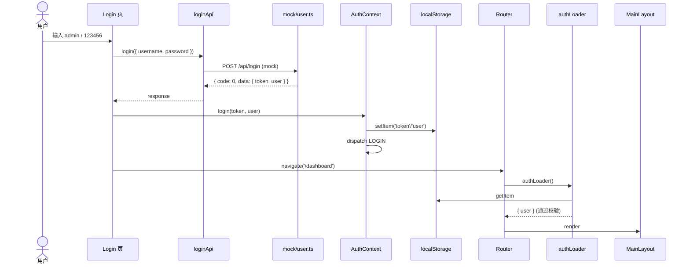
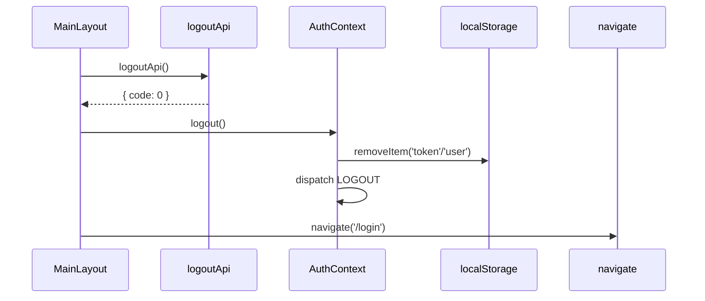

# proxy-admin / 路由与认证

## 本文档覆盖的源文件

- `apps/proxy-admin/src/router/index.tsx`
- `apps/proxy-admin/src/router/guard.ts`
- `apps/proxy-admin/src/contexts/AuthContext.tsx`
- `apps/proxy-admin/src/types/auth.ts`
- `apps/proxy-admin/src/main.tsx`
- `apps/proxy-admin/src/App.tsx`

## 路由骨架

`apps/proxy-admin/src/router/index.tsx`：

```tsx
const router = createBrowserRouter([
  {
    path: '/login',
    element: <Login />,
    loader: publicLoader,
  },
  {
    path: '/',
    element: <MainLayout />,
    loader: authLoader,
    children: [
      { path: '',          element: <Dashboard /> },
      { path: 'dashboard', element: <Dashboard /> },
      { path: 'user',      element: <UserManagement /> },
      { path: 'supplier',  element: <SupplierManagement /> },
      { path: 'log',       element: <LogManagement /> },
      { path: 'system',    element: <SystemSettings /> },
    ],
  },
])
export default function Router() { return <RouterProvider router={router} /> }
```

两个根路由：

- `/login` — 公开路由，`publicLoader` 守卫
- `/` 及所有子路径 — 受保护，`authLoader` 守卫，`MainLayout` 提供外壳

`Dashboard` 挂了两条：`path: ''`（`/`）和 `path: 'dashboard'`（`/dashboard`）都指向它。

## 守卫

`apps/proxy-admin/src/router/guard.ts`：

### `authLoader`（保护路由）

```ts
export const authLoader = async () => {
  const token = localStorage.getItem('token')
  const user = localStorage.getItem('user')

  if (!token || !user) return redirect('/login')

  return { user: JSON.parse(user) }
}
```

- 缺 token 或 user → `redirect('/login')`（Router v6 loader 支持返回 redirect）
- 全 → 返回 user 供页面通过 `useLoaderData()` 拿（当前页面未使用）

**不验证 token 有效性**：验证委托给 `axios` 响应拦截器（`services/request.ts:55-61`）——真实请求 401 时清 storage 跳转登录。

### `publicLoader`（登录页）

```ts
export const publicLoader = async () => {
  const token = localStorage.getItem('token')
  if (token) return redirect('/dashboard')
  return null
}
```

已登录用户访问 `/login` → 跳到 dashboard。

## AuthContext

`apps/proxy-admin/src/contexts/AuthContext.tsx`。React Context + useReducer 管理认证状态。

### State + Reducer

```ts
interface AuthState {
  token: string | null
  user: UserInfo | null
  isAuthenticated: boolean
}

const initialState: AuthState = {
  token: localStorage.getItem('token'),
  user: JSON.parse(localStorage.getItem('user') || 'null'),
  isAuthenticated: !!localStorage.getItem('token')
}

type AuthAction = { type: 'LOGIN'; payload: { token, user } } | { type: 'LOGOUT' }
```

**初始 state 从 localStorage 恢复**——刷新页面后 state 与 storage 一致。

### 提供的方法

```ts
const login = (token, user) => {
  localStorage.setItem('token', token)
  localStorage.setItem('user', JSON.stringify(user))
  dispatch({ type: 'LOGIN', payload: { token, user } })
}

const logout = () => {
  localStorage.removeItem('token')
  localStorage.removeItem('user')
  dispatch({ type: 'LOGOUT' })
}
```

**双写**：localStorage + React state 同步更新。守卫读 storage，组件读 context。

### Hook

```ts
export const useAuth = () => {
  const context = useContext(AuthContext)
  if (context === undefined) throw new Error('useAuth must be used within an AuthProvider')
  return context
}
```

标准 Context 消费包装。使用点：`Login.tsx` 调 `login()`，`MainLayout.tsx` 显示 `user.nickname / user.avatar` 和调 `logout()`。

## Provider 树

`apps/proxy-admin/src/main.tsx`：

```tsx
<React.StrictMode>
  <AuthProvider>
    <ConfigProvider locale={zhCN}>
      <Router />
    </ConfigProvider>
  </AuthProvider>
</React.StrictMode>
```

- **`AuthProvider`** 在最外层——路由内部组件也能用 `useAuth`
- **`ConfigProvider locale={zhCN}`**（Ant Design）——统一中文文案（DatePicker 等）
- **`<Router />`** 就是 `RouterProvider`

`App.tsx` 只是：

```tsx
function App() { return <Router /> }
```

主逻辑都在 `main.tsx` 的 Provider 树。

## 完整登录流程



## 完整登出流程



失败也调 `logout() + navigate('/login')`（`MainLayout.tsx:29-33`）——保证 UI 一致。

## Token 过期处理

`services/request.ts` 拦截器（详见 [services-and-mock.md](./services-and-mock.md)）在 401 时：

```ts
if (error.response?.status === 401) {
  message.error('登录已过期，请重新登录')
  localStorage.removeItem('token')
  localStorage.removeItem('user')
  window.location.href = '/login'   // 硬跳转
}
```

用 `window.location.href` 而非 `navigate` —— 拦截器在 React 组件外，无法用 Router hooks。硬跳转会重新加载整个 app，AuthProvider 重新读 localStorage 得到 unauthenticated state。

## Types

`apps/proxy-admin/src/types/auth.ts`：

```ts
export interface UserInfo { id, username, nickname, avatar, email }
export interface AuthState { token: string | null, user: UserInfo | null, isAuthenticated: boolean }
export interface LoginParams { username, password }
export interface AuthContextType extends AuthState { login(t, u), logout() }
```

## 相关

- 布局与顶部菜单 → [layout-and-menu.md](./layout-and-menu.md)
- axios 拦截器 → [services-and-mock.md](./services-and-mock.md)
