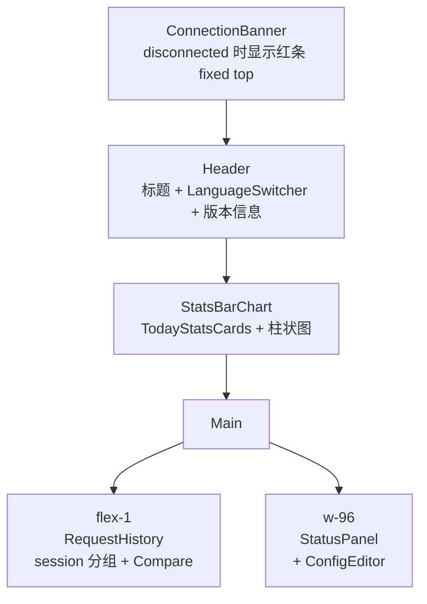

# proxy-cli / 应用外壳

## 本文档覆盖的源文件

- `apps/proxy-cli/src/main.tsx`
- `apps/proxy-cli/src/App.tsx`
- `apps/proxy-cli/src/i18n/index.ts`
- `apps/proxy-cli/src/i18n/locales/zh/*.json`
- `apps/proxy-cli/src/i18n/locales/en/*.json`
- `apps/proxy-cli/src/index.css`
- `apps/proxy-cli/vite.config.ts`

## `main.tsx` — 挂载入口

`apps/proxy-cli/src/main.tsx:1-19`：

```tsx
import ReactDOM from 'react-dom/client'
import { App } from './App'
import './index.css'
import './i18n'
import i18n from './i18n'

document.title = i18n.t('app:title')

const rootElement = document.getElementById('root')
if (!rootElement) throw new Error('Could not find root element to mount to')

ReactDOM.createRoot(rootElement).render(
  <React.StrictMode>
    <App />
  </React.StrictMode>
)
```

- 副作用 import `./i18n` 完成 i18next 初始化
- 同步 `document.title = i18n.t('app:title')`（首次挂载即用当前语言）
- 严格模式包裹（开发时双渲染检查副作用）
- 无 Provider 树包裹——i18next 用全局单例，无路由（SPA 单页面）

## `App.tsx` — 布局

`apps/proxy-cli/src/App.tsx`：

```tsx
export function App(): JSX.Element {
  const { t } = useTranslation('app')
  const { versions } = useConfig()
  const { status, history, requests, stats, todayStats, connectionState, loading } = useWebSocketData()

  return (
    <div className="min-h-screen flex flex-col bg-bg-primary text-text-primary">
      <ConnectionBanner connected={connectionState !== 'disconnected'} />

      <header>
        {t('title')} + LanguageSwitcher
        右侧：claudeVersion + projectVersion
      </header>

      <div className="px-4 py-2">
        <StatsBarChart stats={stats} todayStats={todayStats} />
      </div>

      <main className="flex-1 flex gap-4 p-4">
        <section className="flex-1"> <RequestHistory requests={requests} loading={loading} /> </section>
        <section className="w-96 flex flex-col gap-4">
          <StatusPanel status={{ ...status, history }} />
          <ConfigEditor />
        </section>
      </main>
    </div>
  )
}
```

### 布局网格



### 数据源

- `useConfig()` → `versions`（Claude Code 版本 + 项目版本，一次拉 REST）
- `useWebSocketData()` → 五路状态 + 连接状态 + loading（详见 [data-hooks.md](./data-hooks.md)）
- `status` 与 `history` 分开：`status` 是快照，`history` 是滑动窗口，`StatusPanel` 里用扩展合并显示

## `i18n/index.ts` — 多语言初始化

`apps/proxy-cli/src/i18n/index.ts`：

```ts
i18n
  .use(LanguageDetector)   // navigator + localStorage
  .use(initReactI18next)
  .init({
    resources: {
      zh: { common, app, status, log, config, providers },
      en: { common, app, status, log, config, providers }
    },
    fallbackLng: 'zh',
    ns: ['common', 'app', 'status', 'log', 'config', 'providers'],
    defaultNS: 'common',
    interpolation: { escapeValue: false },
    detection: {
      order: ['localStorage', 'navigator'],
      caches: ['localStorage'],
      lookupLocalStorage: 'i18nextLng'
    }
  })

i18n.on('languageChanged', () => { document.title = i18n.t('app:title') })
```

### 6 命名空间

- `common` — 全局标签、按钮文案（默认命名空间）
- `app` — 顶部标题、Token 类别标签、连接状态、请求相关文案
- `status` — 状态面板的图表标题
- `log` — 日志相关（当前 UI 主流程未大量使用）
- `config` — 配置编辑器的字段名与操作
- `providers` — 供应商管理弹窗

### 语言侦测

- 首次访问：localStorage 无 `i18nextLng` → 用 `navigator.language`
- 切换：`LanguageSwitcher` 调 `i18n.changeLanguage('zh' | 'en')`，写 localStorage
- 每次切换 emit `languageChanged` → 同步刷新 `document.title`

## `LanguageSwitcher.tsx`

`apps/proxy-cli/src/components/LanguageSwitcher.tsx`：

```tsx
const toggleLanguage = () => {
  i18n.changeLanguage(i18n.language === 'zh' ? 'en' : 'zh')
}
```

按钮显示当前的**对面**语言（当前中文时显示 `EN`，反之显示 `中`）+ `Languages` 图标。tooltip 是完整语言名。

## `index.css` + Tailwind 4

`apps/proxy-cli/postcss.config.js` 使用 `@tailwindcss/postcss` 插件。Tailwind 4 直接用 `@import "tailwindcss";` 并通过 CSS 变量定义主题色（`bg-primary / bg-secondary / bg-card / bg-hover / text-primary / text-muted / border / primary / success / warning / error / accent`）。

App 全屏深色主题（`bg-bg-primary text-text-primary`）。所有组件的颜色都是「语义命名」而非硬编码色值——支持将来切换主题。

## `vite.config.ts`

```ts
export default defineConfig({
  plugins: [react()],
  base: '/ui/',
  build: { outDir: 'dist', sourcemap: true },
  server: {
    proxy: {
      '/ui/api': { target: 'http://localhost:3000', ws: true }
    }
  },
  test: { environment: 'jsdom', globals: true, setupFiles: ['./src/test/setup.ts'] }
})
```

- **`base: '/ui/'`**：所有静态资源前缀 `/ui/`（生产由 proxy-core `@fastify/static` 挂在 `/ui/`）
- **dev proxy**：Vite dev server 把 `/ui/api/*` 反代到 `http://localhost:3000`（**⚠️ 与 proxy-core 默认端口 9527 不一致**——如果直接跑 `pnpm dev:proxy-core` 会用 9527，需要手动同步或使用 dev-only 的 port 覆盖）
- **`ws: true`**：把 WebSocket upgrade 请求也代理
- **build.sourcemap: true**：生产也带 sourcemap，便于线上调试

**dev 硬编码 3000**：`vite.config.ts:15` + `hooks/useWebSocketData.ts:88` + `hooks/useLogs.ts:23` 都用 `localhost:3000`。生产模式用 `location.host`。

## 相关文档

- 数据 Hook 的实现 → [data-hooks.md](./data-hooks.md)
- 各组件的 UI 结构 → 后续 `components-*.md`
