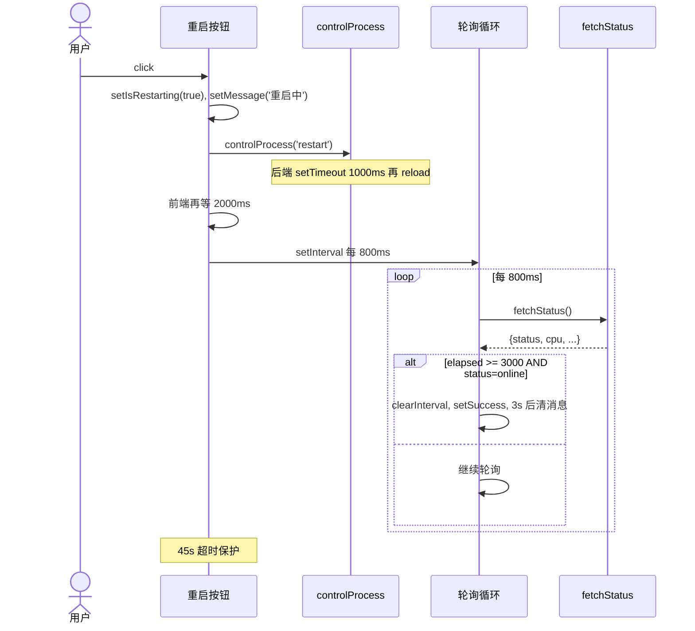
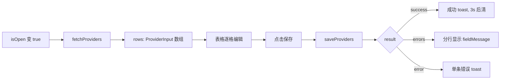

# proxy-cli / 配置类组件

## 本文档覆盖的源文件

- `apps/proxy-cli/src/components/ConfigEditor.tsx`
- `apps/proxy-cli/src/components/ProviderManagerModal.tsx`
- `apps/proxy-cli/src/types/providers.ts`
- `apps/proxy-cli/src/api/providers.ts`

## ConfigEditor

`apps/proxy-cli/src/components/ConfigEditor.tsx`。右侧下半部分——**当前实现只显示两个只读地址卡 + 两个按钮**（重启 + 供应商管理），不再直接编辑 JSON 字段（历史版本曾有完整字段编辑器，现被 `ProviderManagerModal` + 「直接改文件」的模式取代）。

### UI 结构

```
┌ 配置 [重启] [🗄️]
│ ┌ 服务器
│ │ ┌ GlowCard(input)   地址        http://localhost:9527       ┐
│ │ ┌ GlowCard(output)  配置路径    ~/.cc-monitoring            ┐
```

- 顶部 heading + 两个按钮：`RefreshCw` 图标（重启） + `DatabaseZap` 图标（供应商）
- 两张 `GlowCard`：Address（蓝框）+ ConfigPath（绿框）
- Address 硬编码 `http://localhost:9527`（**未从 config 动态取**——遗留 hardcode）
- ConfigPath 用 `configPath.replace(/\/config\.json$/, '')` 去尾巴显示目录部分；未加载时显示 `~/.cc-monitoring`

### 重启流程 `handleRestart`



关键实现细节：

- **前端等待 2s + 至少再等 3s**：即使 PM2 快速重启（<3s），也强制看到"重启中"至少 5s，避免闪烁
- **`elapsed >= minWaitTime` 才检查 online**：防止早期观测到"上一个进程还在" 误判成功
- **800ms 轮询间隔**：兼顾响应速度和请求密度
- **45s 超时兜底**：任何异常都不会永久卡在"重启中"
- **`controlProcess` 请求失败也继续轮询**：重启过程中 API 可能不可达
- **`setIsRestarting(current => ...)`**：函数式 setState，从超时定时器里读最新值

### 供应商弹窗

`isProviderModalOpen` 控制 `<ProviderManagerModal>` 的显隐。

## ProviderManagerModal

`apps/proxy-cli/src/components/ProviderManagerModal.tsx`。全屏 modal + 表格编辑器。

### 数据流



### 字段

`FIELDS` 常量列 9 列（`ProviderManagerModal.tsx:24-34`）：

`name` / `base_url` / `api_key` / `model` / `haiku_model` / `sonnet_model` / `opus_model` / `subagent_model` / `provider`

+ 一列操作按钮（激活 / 删除）。

`EMPTY_ROW` 是所有字段空串 + `default: false`。

### 行为

- **添加行**：`handleAddRow` push 一个 `EMPTY_ROW` 副本
- **删除行**：`window.confirm(...)` 确认后从数组 filter 掉
- **激活**：`handleActivate(index)` 把所有行的 `default` 置 false，仅指定行 true——保证唯一
- **字段编辑**：受控 `<input>`，每次 change 生成新数组
- **保存**：`saveProviders(rows)` 全量提交；成功清空错误、显示 toast；错误 `errors` 数组按 `{row, field, message}` 格式化显示

### `providerToInput`

后端 `Provider` 类型的 `base_url` 等字段是 `string | null`——前端为方便 `<input>` 绑定，把 null 一律转为空串（`ProviderManagerModal.tsx:36-49`）。

### `formatErrors`

用 i18n key `providers:error.fieldMessage` 拼装 `第 X 行: field 校验消息`。

### 自动清除 toast

```ts
useEffect(() => {
  if (!message || messageType !== 'success') return
  const timer = setTimeout(() => { if (mountedRef.current) setMessage(null) }, 3000)
  return () => clearTimeout(timer)
}, [message, messageType])
```

- 只有 success toast 3s 后自动消失；error 常驻直到用户下一次操作
- `mountedRef` 保护 unmount 后 setState

### 关闭 modal 的三种方式

- 点右上角 `Close` 按钮
- 点底部第二个 `Close` 按钮
- 点遮罩背景（`onClick` handler 判断 `e.target === e.currentTarget`）

## 与后端的契约

见 [../proxy-core/providers.md](../proxy-core/providers)。重点：

- POST `/ui/api/providers` **需要 Bearer 认证**（当 `config.auth.token` 或 `UI_AUTH_TOKEN` 设置时）
- 目前前端**不发** Authorization 头 —— 生产环境启用认证后此功能会 401
- Destructive replace：整个表格提交即全量替换后端 providers 表内容

## 类型

`apps/proxy-cli/src/types/providers.ts`：

```ts
export interface Provider {
  id, name, base_url, api_key, model,
  haiku_model?, sonnet_model?, opus_model?, subagent_model?,
  provider, default, created_at, updated_at
}
export interface ProviderInput { ...Provider without id/timestamps }
export interface ProviderValidationError { index, field, message }
export interface ProviderSaveResult { success, errors?, error? }
```

`Provider` 和后端返回结构一致；`ProviderInput` 是前端提交时的形状（同结构，仅所有字段可选空串）。

## 相关

- 后端 SQLite 全量替换实现 → [../proxy-core/providers.md](../proxy-core/providers#saveproviders-db-providers)
- API 客户端 → [api-layer.md](./api-layer.md#saveproviders-providers)
- 通用组件（GlowCard 等） → [components-common.md](./components-common.md)
