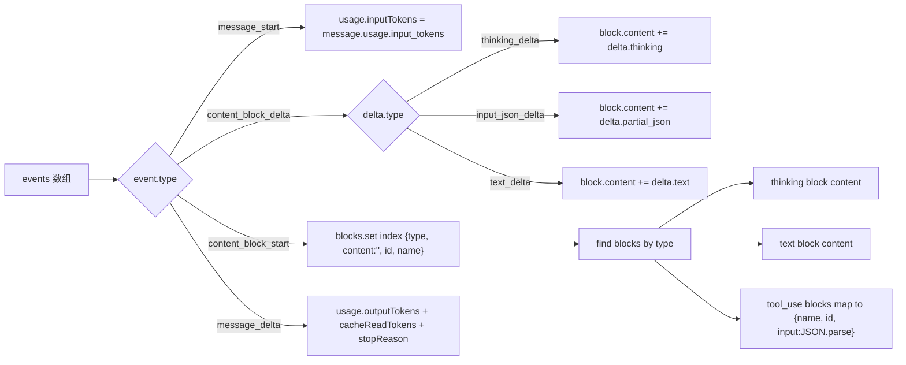

# proxy-cli / 请求类组件

## 本文档覆盖的源文件

- `apps/proxy-cli/src/components/RequestHistory.tsx`
- `apps/proxy-cli/src/components/RequestCard.tsx`
- `apps/proxy-cli/src/components/RequestCompareModal.tsx`
- `apps/proxy-cli/src/components/DiffPanel.tsx`
- `apps/proxy-cli/src/components/ParsedResponseBlocks.tsx`
- `apps/proxy-cli/src/utils/parse-events.ts`

## RequestHistory

`apps/proxy-cli/src/components/RequestHistory.tsx`。左侧主区，功能：

1. 按 `sessionId` **保序**分组
2. 每组可折叠展开（点击 chip）
3. 单卡展开显示详情（Headers / Body / Events）
4. 勾选任意两条 → 「对比」按钮亮起 → 打开 `RequestCompareModal`

### 保序分组

```ts
const sessionGroups: { sessionId, items }[] = []
const groupIndex = new Map<string, number>()
for (const summary of requests) {   // requests 已按 timestamp 倒序
  const idx = groupIndex.get(summary.sessionId)
  if (idx === undefined) {
    groupIndex.set(summary.sessionId, sessionGroups.length)
    sessionGroups.push({ sessionId, items: [summary] })
  } else {
    sessionGroups[idx].items.push(summary)
  }
}
```

- 遍历时保持 `requests` 数组顺序 → 组内自然倒序
- 最新活跃 session（该 session 最新请求最靠前）先被创建 → 组顺序也按活跃度倒序

### 分组头

每 session 分隔条：`─── <sessionId> [<count>] ───`。点数字 chip 展开/收起该组（`expandedSessions: Set<string>`）。

### 选中与对比

```ts
const [selectedIds, setSelectedIds] = useState<string[]>([])

handleToggleSelect(id) {
  setSelectedIds(prev => {
    if (prev.includes(id)) return prev.filter(x => x !== id)
    if (prev.length >= 2) return [prev[1], id]   // FIFO：满 2 时淘汰最早
    return [...prev, id]
  })
}
```

- 上限 2；达到上限后新选择挤掉最早
- 「Compare」按钮 `disabled` 直到 `selectedIds.length === 2`
- 打开 modal，关闭时清空选择

### 单卡展开

`expandedCardId: string | null` —— **只允许一张卡同时展开**（避免多个 Shiki 高亮同时挂）。

## RequestCard

`apps/proxy-cli/src/components/RequestCard.tsx`。一条请求的展现。

### 头部（始终显示）

```
[MM-DD HH:mm:ss]  [MethodTag]  /v1/messages    [TokenBarChart]   3.2s  [ModelTag]  ▸
```

- 时间戳 `formatTime(timestamp, 'monthDayTime')`
- `MethodTag`：GET/POST 底色 + 状态码染色（2xx 绿、非 2xx 红）
- 路径
- `TokenBarChart`：微型四柱条（input/output/cacheRead/cacheCreate）
- `formatDuration`：`(ms / 1000).toFixed(1)`s
- `ModelTag`：紫色 tag
- 展开三角

复选框 `onToggleSelect` 传入时才显示。

### 展开加载

点击头部 → `handleExpand()`：

```ts
if (isExpanded) { onCollapse?.(); return }
setLoading(true)
try {
  const res = await fetch(`/ui/api/requests/${summary.compositeId}`)
  if (!res.ok) throw new Error(`HTTP ${res.status}`)
  const data: RequestDetails = await res.json()
  setDetails(data)
  onExpand?.()
} catch (err) {
  setError(...)
  onExpand?.()   // 仍展开，显示错误
}
```

请求 `GET /ui/api/requests/:compositeId` 拿完整详情（含 headers/body/events）。失败时展开显示错误块 + 重试按钮。

### 展开体（Tabs + 懒渲染）

```tsx
<div ref={detailRef}>
  {inView ? (
    <Tabs
      tabs={[
        { id: 'reqHeaders', label: '请求 Headers' },
        { id: 'reqBody', label: '请求 Body' },
        { id: 'resHeaders', label: '响应 Headers' },
        { id: 'resBody', label: '响应 Body' }
      ]}
      defaultTab="reqHeaders"
      children={{
        reqHeaders: <ShikiHighlighter code={JSON.stringify(headers, null, 2)} lang="json" />,
        reqBody:    <ShikiHighlighter code={JSON.stringify(body, null, 2)} lang="json" />,
        resHeaders: <ShikiHighlighter code={JSON.stringify(resHeaders, null, 2)} lang="json" />,
        resBody:    <>
          <ParsedResponseBlocks events={events} />
          <details><summary>原始 Events ({events.length})</summary>
            {events.map(event => <ShikiHighlighter code={JSON.stringify(event, null, 2)} lang="json" />)}
          </details>
        </>
      }}
    />
  ) : (
    <div>滚动到此处显示详情...</div>
  )}
</div>
```

- `useInViewControl` 提供 `ref + inView`：卡片展开但仍在视口外时，`inView=false`，不渲染 tabs（因 Shiki 是重组件）
- 视口内滚动到时才真正渲染

### 三种响应体展示

`resBody` 里按可用性分三档：

1. **有 events**：`ParsedResponseBlocks`（结构化）+ 折叠的「原始 Events」
2. **有 error**：显示错误块
3. **都无**：显示"无数据"

## ParsedResponseBlocks

`apps/proxy-cli/src/components/ParsedResponseBlocks.tsx`。把 SSE events 数组解析后**分类显示**：

```tsx
const parsed = parseEvents(events)
```

三个块（有则显示）：

1. **🤔 AI 思考过程**（`thinking`）：蓝色区，`whitespace-pre-wrap` 保留换行
2. **💬 AI 回复内容**（`text`）：绿色区，`<ReactMarkdown>` 渲染 Markdown（含 typography）
3. **🔧 工具调用**（`toolCalls`）：紫色区，每个 tool 显示 `name (id)` + `<ShikiHighlighter lang="json">` 参数

## parse-events

`apps/proxy-cli/src/utils/parse-events.ts`。核心解析器：

```ts
export interface ParsedResponse {
  thinking?: string
  text?: string
  toolCalls?: Array<{ name: string; id: string; input: Record<string, any> }>
  usage: { inputTokens: number; outputTokens: number; cacheReadTokens?: number }
  stopReason: string
}
```

流程：



**与后端 `inject-loop.ts` 的 `parseUpstreamEvents` 的区别**：

- 前端把 thinking 单独归到 `thinking` 字段；后端把 thinking delta 累加到 text（因为后端 `blocksToAssistantContent` 只保留 text/tool_use）
- 前端返回**平铺的字段**（thinking/text/toolCalls）供 UI 显示；后端返回**有序 blocks 数组**供再次转发
- 前端 `parseToolInput` 尝试 JSON.parse 失败降级 `{ _raw: content }`；后端降级 `{}`

## RequestCompareModal

`apps/proxy-cli/src/components/RequestCompareModal.tsx`。全屏 modal，宽 90vw × 高 90vh：

```tsx
interface Props { leftId: string; rightId: string; onClose: () => void }
```

- 挂载时 `Promise.allSettled([fetch left, fetch right])` 并发拉两份详情
- 每份独立处理成功/失败（`errorLeft / errorRight`）
- 显示 4 个 Tab（Headers / Body / resHeaders / resBody），每个 Tab 里用 `DiffPanel` 显示两侧对比

### 序列化

```ts
function stringify(value: unknown): string {
  if (value == null) return ''
  try { return JSON.stringify(value, null, 2) } catch { return String(value) }
}
```

- JSON.stringify 失败（循环引用等）→ `String(value)` 兜底
- null/undefined → 空串（DiffPanel 会显示"无数据"）

### 关闭清理

`useEffect` cleanup 用 `cancelled` 标志防止 unmount 后 setState。

## DiffPanel

`apps/proxy-cli/src/components/DiffPanel.tsx`。基于 `@pierre/diffs`：

```tsx
const fileDiff = useMemo(() => {
  if (!leftText || !rightText) return null
  const oldFile = { name: `left.${lang}`, contents: leftText, lang }
  const newFile = { name: `right.${lang}`, contents: rightText, lang }
  try { return parseDiffFromFile(oldFile, newFile) }
  catch (err) { console.error(...); return null }
}, [leftText, rightText, lang])

return fileDiff ? <FileDiff fileDiff={fileDiff} /> : <div>无数据</div>
```

- `parseDiffFromFile` 产生行级 diff 结构
- `<FileDiff>` 是 `@pierre/diffs/react` 提供的展示组件
- `lang` 默认 `'json'` — 语法高亮
- 单侧空 → 直接显示"无数据"（可优化为「新增/删除」标记，当前实现选择简单）

## 相关

- 请求详情 API → [api-layer.md](./api-layer.md#fetchrequests-limit--1000)
- 后端 events 结构 → [../proxy-core/tool.md](../proxy-core/tool#每步解析)
