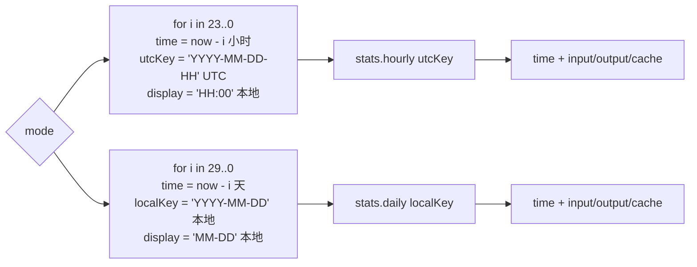
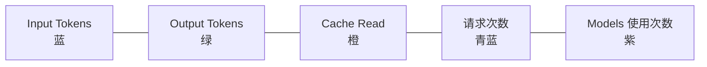

# proxy-cli / 统计类组件

## 本文档覆盖的源文件

- `apps/proxy-cli/src/components/StatsBarChart.tsx`
- `apps/proxy-cli/src/components/TodayStatsCards.tsx`
- `apps/proxy-cli/src/components/TokenBarChart.tsx`
- `apps/proxy-cli/src/components/GlowCard.tsx`
- `apps/proxy-cli/src/components/chart-theme.ts`

## StatsBarChart

`apps/proxy-cli/src/components/StatsBarChart.tsx`。顶部区域主要视图：

```tsx
interface StatsBarChartProps { stats: StatsData; todayStats: TodayStats }
```

三个视觉块：

1. **TodayStatsCards**（今日五张卡）——见下文
2. **Hour/Day 切换按钮**
3. **Recharts BarChart**（24 小时 / 30 天）

### 时间尺度构造 `generateTimeScale(mode)`

前端**主动构造完整时间轴**（24 或 30 个桶），再从 `stats.hourly / stats.daily` 匹配值。空桶显示为 0——避免柱状图不连续。



- **hourly 用 UTC key**（`time.getUTCFullYear() ...`）：因为后端 `strftime('%Y-%m-%d-%H', timestamp)` 是 UTC
- **daily 用本地 key**：后端 `datetime(timestamp, '+8 hours')` 硬编码 +8——在 UTC+8 用户上表现是"本地"日期串，其他时区用户会跟真实本地日期错开
- display 只用于 X 轴 tick 文本

### 图表本身

- `<BarChart>` + 三个 `<Bar>`：input（蓝）、output（绿）、cache（橙）
- Y 轴 `tickFormatter={formatCompactNumber}` 用 `Intl.NumberFormat compact` 显示 1.2K / 1M / 1.5B
- Tooltip 深色主题
- `Legend`
- 容器 `<ResponsiveContainer height={200}>`

### 底部脚注

`{t('lastUpdated')}: {formatTime(stats.lastUpdated)}` — 从聚合表 `MAX(updated_at)` 读的时间戳，格式化为本地日期时间。

## TodayStatsCards

`apps/proxy-cli/src/components/TodayStatsCards.tsx`。五张 GlowCard 排一行：



**卡 1-4** 结构相同：

- 顶部：标签文字 + `lucide-react` 图标（`ArrowDownToLine / ArrowUpFromLine / DatabaseZap / Activity`）
- 中间：`<CountUp>` 数字动画（0 → value，1.5s，千分位逗号），`enableReinitialize + preserveValue` 保证增量更新时接续动画
- 颜色：`TOKEN_COLORS.{input, output, cacheRead, cacheCreate}`

**卡 5** 特殊——「模型使用」用竖向柱条：

- `Object.entries(today.models)` 遍历模型
- 每个模型一根小柱条，高度按 `count / maxCount * 100%`，最小 8%
- hover 显示 tooltip `{model}: {count}`
- 无数据时显示 `t('today.noModels')`
- 用紫色 `#A855F7`（`MODEL_COLOR` 常量）

## TokenBarChart

`apps/proxy-cli/src/components/TokenBarChart.tsx`。**单条请求的 Token 迷你柱状图**（不是全局统计）。用在 `RequestCard` 的头部：

```tsx
interface TokenBarChartProps { usage: TokenUsage }
```

四根柱条：input / output / cacheRead / cacheCreate（TOKEN_COLORS）。

- 每根柱条宽 `w-3` 高度按值 / 最大值 * 16px 计算，最小 2px
- 布局 `flex items-end gap-1` 使柱子等宽底对齐
- hover 每根显示 tooltip `{label}: {value}`

**微型可视化**：让请求列表一眼看出成本占比。

## GlowCard

`apps/proxy-cli/src/components/GlowCard.tsx`。带旋转发光边框的卡片容器：

```tsx
export function GlowCard({ children, color }: { children: React.ReactNode; color: string }): JSX.Element
```

**实现思路**：

- 外层 `overflow-hidden rounded-lg`
- **背景层**：一个 300% × 300% 的 `conic-gradient`（透明→彩色→透明的圆锥），用 `animation: glowRotate 6s linear infinite` 无限旋转
- **遮罩层**：内嵌 `inset-[1px]` 的 `bg-bg-secondary`，只留 1px 边框缝隙露出旋转的渐变 → 视觉上是"发光边框"
- **内容层**：`relative z-10 p-3` 承载 children
- **`colorWithAlpha(alpha)`**：把 hex `#RRGGBB` 转成 `rgba()`，让渐变里能用 alpha 过渡

用于 `TodayStatsCards` 的 5 张卡 + `ConfigEditor` 的两张地址卡——需要视觉焦点的元素。

## chart-theme

见 [components-status.md](./components-status.md#chart-theme)。本组分文档主要复用 `TOKEN_COLORS`。

## 数据流

```
useWebSocketData → stats (预聚合) + todayStats (实时)
                ↓
              App.tsx
                ↓
         StatsBarChart(stats, todayStats)
             ├── TodayStatsCards(todayStats)  → 5 张 GlowCard
             └── BarChart(generateTimeScale)  → 3 组柱条
```

`todayStats` 在收到 WebSocket `type=request` 消息时前端主动重新 GET，让今日数据近实时；`stats` 只在收到 `stats notify` 消息（目前无发送方）或首帧 REST 时更新。

## 相关

- 数据管道 → [data-hooks.md](./data-hooks.md)
- 后端聚合 → [../proxy-core/stats.md](../proxy-core/stats)
