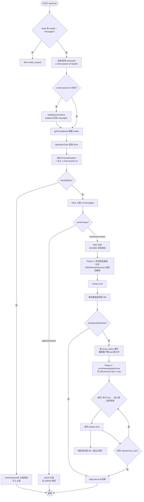

# proxy-core / Chat API (`/api/chat`)

## 本文档覆盖的源文件

- `apps/proxy-core/src/server/chat-route.ts`
- `apps/proxy-core/src/utils/sse-stream-processor.ts`
- `apps/proxy-core/src/utils/inject-loop.ts`（`runStreamingInjectLoop` 部分）
- `apps/proxy-core/src/utils/sse-writer.ts`（`writeSSEEvent` 部分）
- `apps/proxy-core/src/utils/request-writer.ts`（session 管理 + DB）

## 与 `/v1/*` 的区别

`/v1/*` 是纯透明代理（proxy.md），不改请求体结构，只做 header 过滤 + SSE pipe。

`/api/chat` 是**增强型代理**，在转发前和转发后对请求/响应做多层处理：

| 能力 | `/v1/*` | `/api/chat` |
|---|---|---|
| 请求体修改 | 仅 model 替换 | model 替换 + MCP tool 注入 |
| 响应处理 | 透传原样 | SSE 流式转发 + inject loop 续接 |
| Session 管理 | 从 header 读 `x-claude-code-session-id` | 生成/复用 `x-chat-session-id`，支持 resume |
| DB 记录 | 单条（原始请求） | 多条（原始 + 每次 loop 迭代独立记录） |
| 客户端信号 | 无 | `proxy_status` SSE 事件通知 tool 执行状态 |

## 请求流程总览

```
客户端 → Fastify (解析 body)
  → 生成/复用 sessionId
  → session resume（如有历史）
  → model tier 替换
  → MCP tool 注入
  → header 过滤 + 注入 x-chat-session-id
  → fetch 上游 /v1/messages
  → 响应分支处理（见下文）
```



## Session 管理

### Session ID 生成

```typescript
const providedSessionId = request.headers['x-chat-session-id'] as string | undefined
const sessionId = providedSessionId || randomUUID()
forwardHeaders['x-chat-session-id'] = sessionId
```

- 客户端首次请求不带 `x-chat-session-id` → server 生成 UUID
- 生成的 sessionId 注入到 `forwardHeaders`，上游始终能看到此 header
- Session ID 通过 response header `x-chat-session-id` 返回给客户端
- 客户端后续请求带上此 header → server 复用同一 sessionId

### Session Resume

当客户端带 `x-chat-session-id` 且 DB 中有历史记录：

```typescript
if (providedSessionId) {
  const history = loadSessionHistory(providedSessionId)
  if (history) {
    request.body.messages = [...history.messages, ...request.body.messages]
    if (history.system && !request.body.system && !request.body.system_prompt) {
      request.body.system = history.system
    }
  }
}
```

- `loadSessionHistory(sessionId)`：从 SQLite 加载该 session 的历史 messages + system prompt
- 历史 messages prepend 到当前请求的 messages 前面
- system prompt 仅在当前请求未提供时 carry over

## Model Tier 替换

```typescript
const originalModel = request.body.model
const proxyModel = getProxyModel(originalModel, resolved)
if (proxyModel) {
  request.body.model = proxyModel
}
```

根据 provider 配置的 tier 映射替换请求中的 model。例如：`claude-sonnet` → provider 的 `sonnet_model`（可能是 `glm-5.1` 等国内模型）。

## MCP Tool 注入

```typescript
const injectedNames = injectMcpTools(request.body)
const injected = injectedNames.length > 0
```

与 `/v1/*` 路径的 tool 注入相同（详见 [tool.md](./tool)）。在请求体的 `tools` 数组末尾追加已启用 tool 的三件套（name + description + input_schema）。

**关键区别**：`/api/chat` 使用 `injectMcpTools`（仅注入 MCP 动态 tool），而 `/v1/*` 使用 `injectTools`（注入所有已启用 tool，包括 probe/curl）。

## SSE 流式响应（核心路径）

这是 `/api/chat` 的主要响应路径。**统一处理**，无论是否有 tool 注入——始终先流式转发原始 SSE，stream end 后再检测注入。

### Phase 1：流式转发原始 SSE

```typescript
reply.hijack()
reply.raw.writeHead(response.status, { ...Object.fromEntries(response.headers), 'x-chat-session-id': sessionId })

const processor = new SSEStreamProcessor(reply.raw)
const nodeStream = Readable.fromWeb(response.body)

nodeStream.on('data', (chunk) => processor.processChunk(chunk))
```

**SSEStreamProcessor** 的核心职责：

1. **转发**：`processChunk(chunk)` 中 `this.raw.write(chunk)` 把原始 chunk 立即写给客户端
2. **解析**：同步拆行解析 `data:` JSON，push 到 `events[]`
3. **累积状态**：增量更新 `contentBlocks` Map + `stopReason` + `usage`
4. **跨 chunk 行边界**：`leftover` 缓冲不完整行，下次 chunk 补齐

```
上游 SSE chunk → SSEStreamProcessor.processChunk()
  → reply.raw.write(chunk)    // 客户端立即收到原始数据
  → 解析 data: 行 → events[]
  → processEvent → contentBlocks / stopReason / usage
```

客户端看到的是**与上游完全一致的原始 SSE 流**，包括 thinking 块、text 块、tool_use 块。零延迟，零缓冲。

### SSEStreamProcessor 内部结构

```
SSEStreamProcessor
├── raw: ServerResponse              // reply.raw，用于转发 chunk
├── events: any[]                    // 解析出的 JSON 事件（供 DB 记录）
├── contentBlocks: Map<number, ParsedBlock>  // 增量累积的 content block 状态
├── stopReason: string               // 从 message_delta 捕获
├── usage: any                       // 从 message_delta 捕获
├── leftover: string                 // 跨 chunk 的不完整行缓冲
│
├── processChunk(chunk)              // 转发 + 解析 + 累积
├── flushLeftover()                  // stream end 后处理残留行
├── processEvent(e)                  // 增量更新 contentBlocks/stopReason
├── getParsedUpstream()              // 从累积状态构建 ParsedUpstream
└── hasInjectedToolUse()             // stopReason=tool_use + findInjectedCall
```

`processEvent` 逻辑与 `parseUpstreamEvents` 完全一致，改为逐事件调用：

| 事件类型 | 累积操作 |
|---|---|
| `content_block_start` | `contentBlocks.set(index, {type, text/id/name/input 初始化})` |
| `content_block_delta` | 累加 text/thinking/input 到对应 block |
| `message_delta` | 更新 stopReason + usage |

### Stream End → 检测 + 分支

```typescript
nodeStream.on('end', async () => {
  processor.flushLeftover()

  // 保存原始请求到 DB（第 1 条记录）
  requestData.response!.events = processor.events
  await saveRequestDB(sessionId, cloudRequestId, requestData)
  pushNewRequest(...)

  if (processor.hasInjectedToolUse()) {
    // 发 proxy_status → 跑 inject loop
    ...
  }

  reply.raw.end()
})
```

**关键设计**：DB 第 1 条记录保存的是 `processor.events`——客户端实际收到的原始 SSE 事件。DB 记录与客户端看到的内容**完全一致**。

### Phase 2：Streaming Inject Loop

当 `hasInjectedToolUse()` 返回 true（即 `stop_reason === 'tool_use'` 且命中了注入的 MCP tool），进入 Phase 2。

#### proxy_status 信号

```typescript
writeSSEEvent(reply.raw, { type: 'proxy_status', status: 'tool_executing', tool: injectedCall?.name })
```

在第一条 `message_stop` 后、loop 开始前，发一个自定义 SSE 事件：

```
event: proxy_status
data: {"type":"proxy_status","status":"tool_executing","tool":"mcp__draw-io__list-documents"}
```

**客户端如何理解**：
- `proxy_status` → 这是 proxy 自定义事件，不是 Anthropic API 标准事件
- `status: tool_executing` → proxy 正在代行这个 tool，客户端不需要自己执行
- 同 SSE 连接上还有续接数据，继续监听
- 客户端可据此显示"调用工具中"状态

#### runStreamingInjectLoop

```typescript
await runStreamingInjectLoop({
  initialParsed: processor.getParsedUpstream(),
  body: request.body,
  callUpstream: async (b) => {
    const r = await fetch(targetUrlStr, { ... })
    return { response: r, requestId: loopRequestId }
  },
  streamAndParse: async (loopResponse) => {
    const loopProcessor = new SSEStreamProcessor(reply.raw)
    // 流式转发 loop 迭代的 SSE 到同一 reply.raw
    return { processor: loopProcessor, statusCode: loopResponse.status }
  },
  saveIterationDB: async (loopRequestId, loopProcessor, loopStatusCode, loopBody) => {
    // 独立 DB 记录
    await saveRequestDB(...)
    pushNewRequest(...)
  },
  raw: reply.raw
})
```

**每次迭代的流程**：

1. `findInjectedCall(parsed)` → 找命中的 tool_use block
2. `tool.exec(call.input)` → 本地执行 tool，得 result
3. `body.messages.push(assistant + tool_result)` → 追加对话
4. `callUpstream(body)` → fetch 上游，获取新 SSE 流
5. `streamAndParse(response)` → **流式转发到同一 reply.raw**（客户端实时看到续接）
6. `saveIterationDB(...)` → 独立 DB 记录（第 N 条）
7. 检查新 stream 的 stopReason → 还有 tool_use 则继续迭代，end_turn 则结束

**与旧 `runInjectLoop` 的核心区别**：

| | runInjectLoop（旧） | runStreamingInjectLoop（新） |
|---|---|---|
| 上游响应处理 | `await response.text()` 全量缓冲 | `SSEStreamProcessor` 流式转发 |
| 客户端看到 | 合成 SSE（仅 text，`writeTextAsSSE`） | 原始 SSE（thinking + text + tool_use） |
| DB 记录 | 原始 events 存第 1 条，loop 结果合并 | 原始 + 每次迭代独立记录 |
| 返回值 | `{ text, iterations }` | `{ iterations }`（text 已实时流到客户端） |
| 连接模式 | 缓冲完毕后一次性 `reply.raw.end()` | 同连接续接，`reply.raw.end()` 在最后 |

### 完整 SSE 时序示例

一次带 MCP tool 注入的 SSE 响应时序：

```
→ 客户端发出 POST /api/chat

← SSE Phase 1：原始上游响应（实时流到客户端）
  event: message_start          {id: "msg_xxx", model: "glm-5.1"}
  event: content_block_start   {index: 0, type: "thinking"}
  event: content_block_delta   {index: 0, delta: {thinking_delta: "用户要我画SSR..."}}
  ...（多个 thinking_delta）
  event: content_block_stop    {index: 0}
  event: content_block_start   {index: 1, type: "text"}
  event: content_block_delta   {index: 1, delta: {text_delta: "当然可以！"}}
  ...（多个 text_delta）
  event: content_block_stop    {index: 1}
  event: content_block_start   {index: 2, type: "tool_use", name: "mcp__draw-io__list-documents"}
  event: content_block_delta   {index: 2, delta: {input_json_delta: "{}"}}
  event: content_block_stop    {index: 2}
  event: message_delta         {delta: {stop_reason: "tool_use"}}
  event: message_stop

← proxy_status 信号
  event: proxy_status           {status: "tool_executing", tool: "mcp__draw-io__list-documents"}

← SSE Phase 2：loop 迭代（实时流到客户端，同一连接）
  event: ping                   {type: "ping"}
  event: message_start          {id: "msg_yyy", model: "glm-5.1"}
  event: content_block_start   {index: 0, type: "thinking"}
  ...（thinking 块）
  event: content_block_start   {index: 1, type: "text"}
  event: content_block_delta   {index: 1, delta: {text_delta: "没有打开的文档"}}
  ...（text 块）
  event: message_delta         {delta: {stop_reason: "end_turn"}}
  event: message_stop

← 连接关闭（reply.raw.end）
```

客户端判断逻辑：
- `stop_reason: tool_use` + `proxy_status` → 显示"调用工具中"，继续监听
- `stop_reason: end_turn` → 最终完成，关闭连接

### DB 记录结构

一条 chat 请求在 DB 中可能有 1~N 条记录：

| 记录 | requestId | 内容 | 来源 |
|---|---|---|---|
| 第 1 条 | `cloudRequestId` | 原始上游 SSE events（含 thinking + text + tool_use） | Phase 1 `processor.events` |
| 第 2 条 | `loop_xxx_1` | 第 1 次 loop 迭代的 SSE events | Phase 2 `loopProcessor.events` |
| 第 N 条 | `loop_xxx_N` | 第 N 次 loop 迭代的 SSE events | Phase 2 |

所有记录共享同一 `sessionId`，通过 `compositeId = sessionId:requestId` 关联。

## JSON 响应（非流式）

当上游返回 `content-type: application/json`（通常是错误或非流式请求）：

1. 缓冲完整 JSON body
2. 检测是否有 injected tool_use → 跑 `runJsonInjectLoop`（与 SSE 版对称，但处理 JSON body）
3. 注入 `_sessionId` 到 response body + `x-chat-session-id` header
4. 返回给客户端

JSON 路径不做流式处理（JSON 本身不是流式协议）。详见代码 `chat-route.ts:160-292`。

## Mock 拦截

`shouldMock(body)` 检测 user message 中是否含 `__MOCK__`。命中时：

```typescript
reply.hijack()
reply.raw.writeHead(200, { 'content-type': 'text/event-stream', ... })
writeTextAsSSE(reply.raw, '[PoC] ...', `msg_poc_chat_${request.id}`)
reply.raw.end()
```

不上上游，直接合成 SSE 返回。用于 PoC 测试。

## Header 处理

### 请求 header 过滤

```typescript
const forwardHeaders = filterForwardHeaders(extractSafeHeaders(request.headers), resolved.apiKey)
forwardHeaders['x-chat-session-id'] = sessionId
```

- 删除 `host`（阿里云 404）、`content-length`（长度变化）
- 保留 `anthropic-version`、`x-api-key`、`accept: text/event-stream`
- 有 provider key 时覆盖 `x-api-key` 和 `authorization`
- **注入 `x-chat-session-id`**：上游始终能看到此 header

### 响应 header

SSE 分支：
```typescript
reply.raw.writeHead(response.status, { ...Object.fromEntries(response.headers), 'x-chat-session-id': sessionId })
```

保留上游所有 header + 注入 session ID。

JSON 分支：
```typescript
reply.header('x-chat-session-id', sessionId)
```

## 边界情况

### 上游返回错误（4xx/5xx）

SSE 分支正常转发原始错误 SSE，不触发 inject loop。DB 记录包含错误事件。

### 客户端断连

`reply.raw.destroyed` 检查。`runStreamingInjectLoop` 每次迭代前检查此标志，断连时中断 loop。

### thinking block signature

`blocksToAssistantContent` 跳过 thinking 块——Anthropic extended thinking 有 signature 校验，把 thinking 塞回请求会引发不一致。loop 追加 assistant content 时只包含 text + tool_use。

### 跨 chunk 行边界

`SSEStreamProcessor.leftover` 缓冲不完整行。如果一个 `data: {...}` 事件跨 chunk 被截断，前半段留在 leftover，下次 chunk 补齐后完整解析。`flushLeftover()` 在 stream end 后处理最后的残留。

### 多次 tool_use

如果上游在一条消息中同时调用多个 tool，`findInjectedCall` 返回第一个命中的。每次 loop 迭代处理一个 tool，如果后续迭代仍有 tool_use 则继续循环。

## 关键设计决策

1. **统一 SSE 路径**：无论是否有 tool 注入，SSE 响应始终走同一条路径（流式转发 + stream end 后检测）。不再区分"注入路径"和"passthrough 路径"。

2. **原始 SSE 透传**：客户端看到的是与上游完全一致的原始 SSE 流，包括 thinking 块、text 块、tool_use 块。不做任何合成或过滤。

3. **同连接续接**：inject loop 的结果在同一 SSE 连接上续接，不新建 HTTP 连接。客户端从 `message_stop` 到下一个 `message_start` 之间看到 `proxy_status` 事件和可能的 `ping` 保活。

4. **DB 记录一致性**：第 1 条 DB 记录的 events 与客户端实际收到的完全一致。每次 loop 迭代有独立 DB 记录。

5. **`proxy_status` 自定义事件**：在第一条 `message_stop` 后、loop 开始前发出，让客户端知道 proxy 在代行 tool。这是 proxy 自定义协议扩展，不是 Anthropic API 标准事件。

6. **`x-chat-session-id` 注入到 forwardHeaders**：上游始终能看到 session ID header，proxy 不需要管理 resume 逻辑，只需透传。

## 相关文档

- Tool 注入机制 → [tool.md](./tool)
- `/v1/*` 纯代理路径 → [proxy.md](./proxy)
- SSE 写入工具 → [tool.md#合成-sse-writer](./tool#合成-sse-writer)
- 数据层（DB + session 管理）→ [data-layer.md](./data-layer)
