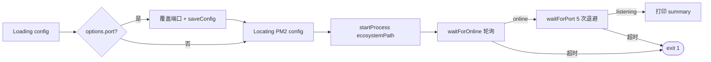

# proxy-core / CLI 命令

## 本文档覆盖的源文件

- `apps/proxy-core/src/cli/index.ts`
- `apps/proxy-core/src/cli/commands/*.ts`
- `apps/proxy-core/src/utils/pm2.ts`
- `apps/proxy-core/src/utils/net.ts`

## 命令总览

`cli/index.ts` 注册 8 条显式命令 + 1 条隐藏 `clean-requests`。全局参数 `-c, --config <path>` 通过 `preAction` hook 写入 `paths.setConfigPathOverride`。

| 命令 | 文件 | 摘要 |
|---|---|---|
| `start` | `commands/start.ts` | PM2 守护启动 + 端口探测 |
| `stop` | `commands/stop.ts` | 停止 PM2 进程 |
| `status` | `commands/status.ts` | 打印状态快照 |
| `logs [n]` | `commands/logs.ts` | 打印最近 n 行日志 |
| `config` | `commands/config.ts` | show / set / reset |
| `reload` | `commands/reload.ts` | 优雅重启 + 探测 |
| `test` | `commands/test.ts` | HEAD 探测上游 |
| `ui` | `commands/ui.ts` | 打开浏览器面板 |
| `clean-requests` | `cli/index.ts:63-78` | 清理旧请求（隐藏） |

进程名统一为 `cc-monitoring`（多个命令写死 `PROCESS_NAME = 'cc-monitoring'`）。

## start

`apps/proxy-core/src/cli/commands/start.ts`：



- **步骤 1**：`loadConfig()`；若命令行传 `-p 8080`，就地改 `config.server.port` 并 `saveConfig()` 持久化
- **步骤 2**：用 `getCallerDirname('../cli')` 推 `ecosystemPath = <cli>/../../ecosystem.config.cjs`（编译后 `dist/cli/../../ecosystem.config.cjs`）
- **步骤 3**：`startProcess(ecosystemPath)` → `pm2.connect()` + `pm2.start()` + `pm2.disconnect()`（`utils/pm2.ts:74-78`）
- **步骤 4**：`waitForOnline('cc-monitoring', 8000, 300)`：8 秒内每 300ms 轮询 `pm2.list()` 直到 `pm2_env.status === 'online'`（`utils/pm2.ts:93-107`）
- **步骤 5**：`waitForPort(host, port, callback)`：递增退避 1s → 2s → 3s → 4s → 5s（累计 15s）尝试 TCP 连接（`utils/net.ts:30-43`）；host 是 `0.0.0.0`/`::`/空时探测 `127.0.0.1`
- **失败**：任何一步失败打印 `~/.cc-monitoring/logs/error.log` 路径然后 `process.exit(1)`

Summary 输出四行：Listening / Forwarding to / Dashboard / Logs。

## stop

`commands/stop.ts:3-7`：直接 `stopProcess('cc-monitoring')`，内部 `pm2.stop()`。无进度、无探测。

## status

`commands/status.ts:3-17`：`getProcessStatus('cc-monitoring')` 返回

```ts
{ name, status, cpu, memory, uptime, restarts }
```

（`utils/pm2.ts:109-125`）。文字打印四行；未找到进程输出 `Server not running`。

## logs [n]

`commands/logs.ts`：

```ts
const config = await loadConfig()
const logs = await readLogs(config.logging.file, {
  limit: n ? parseInt(n) : 50,
  level: options.level,
  grep: options.grep
})
logs.forEach(line => console.log(line))
```

`readLogs`（`logger/index.ts:96-133`）：读整个日志文件，可选按 Pino 数值 level 过滤（`LEVEL_MAP`），可选大小写不敏感的 substring 匹配。返回最近 `limit` 行。

## config

`commands/config.ts`：

- `config show`：`loadConfig()` + `JSON.stringify(..., null, 2)`
- `config set <key> <value>`：`key.split('.')` 逐层下探（`server.port` / `proxy.target` 等），保留类型（`typeof current[lastKey]` 决定 `parseInt` / `=== 'true'` / 原样字符串），然后 `saveConfig(config)`
- `config reset`：调 `resetConfig()`（`config/index.ts:43-64`）覆盖为默认配置

任何非法 action 打印 `Invalid action. Use: show, set, reset`。

## reload

`commands/reload.ts`：结构与 start 类似但不需要 `startProcess`：

1. `loadConfig` 拿 host/port
2. `reloadProcess('cc-monitoring')`（`pm2.reload`，是零停机）
3. `waitForOnline`
4. `waitForPort`
5. 打印 summary（不再打印 forwarding target）

## test

`commands/test.ts`：

```ts
const res = await fetch(config.proxy.target, {
  method: 'HEAD',
  signal: AbortSignal.timeout(10000)
})
```

HEAD + 10 秒超时。打印 `Success! Target reachable. Status: <code>` 或 `Connection failed: <msg>`。

## ui

`commands/ui.ts`：

1. `getProcessStatus`：未运行则报错并 return
2. 计算 `uiDistPath`（`../../../ui/dist`——⚠️ 这个路径实际不指向 proxy-cli，是遗留 bug 但不影响主流程，因为 `--build` 才会用到，多数情况 proxy-cli 早已 build 过）
3. 若 `--build` 或 dist 不存在：`execSync('pnpm --filter @proxy/ui build', ...)`
4. `open(base + '/ui')`：动态 import `open`（ESM-only 库）

`open` 的选择让 macOS 用 `open` 命令、Linux 用 `xdg-open`、Windows 用 `start`。

## clean-requests（隐藏）

`cli/index.ts:63-78`：

```bash
proxy clean-requests --days 7
```

动态 import `loadConfig` + `configureDbPath` + `cleanOldRequestsDB` 后：

```ts
const days = parseInt(options.days)   // 默认 '7'
await cleanOldRequestsDB(days)         // DELETE FROM requests WHERE timestamp < cutoff
```

`cleanOldRequestsDB` 在 `days <= 0` 时直接 return（保留全部）。

## PM2 封装（`utils/pm2.ts`）

所有 PM2 交互都通过 promisify：

| 内部 | 对外 |
|---|---|
| `pm2Connect / pm2Disconnect` | 每次调用后必须 disconnect，否则 daemon 会误以为持有客户端 |
| `pm2Start(options)` | 支持 string（ecosystem 路径） 或 object；错误可能是数组 |
| `pm2Stop / pm2Reload` | 单参 name |
| `pm2List` | 返回原始 list |
| `startProcess / stopProcess / reloadProcess` | 三合一（connect → op → disconnect） |
| `waitForOnline(name, timeoutMs, intervalMs)` | 只在此函数内持有一次连接 + 轮询列表 |
| `getProcessStatus(name)` | 单次快照 |

**为什么用 `createRequire`**：pm2 是 CJS，本文件是 ESM。`utils/pm2.ts:8-15`：

```ts
const requireCjs: NodeRequire = (() => {
  try { return createRequire(getCurrentModuleUrl()) } catch { return require }
})()
const pm2 = requireCjs('pm2') as any
```

`getCurrentModuleUrl()` 是 `esm-dirname.ts` 提供的包装器，避免直接写 `import.meta.url`（ts-jest CJS 编译会解析错）。fallback 是 CJS 环境（Jest）的 `require`。

## `waitForPort` 细节（`utils/net.ts`）

```ts
for (let attempt = 1; attempt <= 5; attempt++) {
  await sleep(attempt * 1000)   // 累计 1+2+3+4+5 = 15s
  onAttempt?.(attempt, 5)
  if (await tryConnect(target, port)) return true
}
return false
```

`tryConnect` 是 `net.createConnection` 加 1s socket timeout；success/timeout/error 都 destroy 并 resolve。start / reload 命令都会传一个 `onAttempt` 回调，用 ora spinner 显示 `attempt X/5`。

## 全局参数流转

```
proxy -c /tmp/my.json start
  ↓
Commander preAction hook (index.ts:20-25)
  ↓
setConfigPathOverride('/tmp/my.json')  → paths.ts 内部变量
  ↓
loadConfig()
  ↓
getConfigPath()  → 检查 override → 返回 '/tmp/my.json'
```

同样机制适用于所有子命令。
