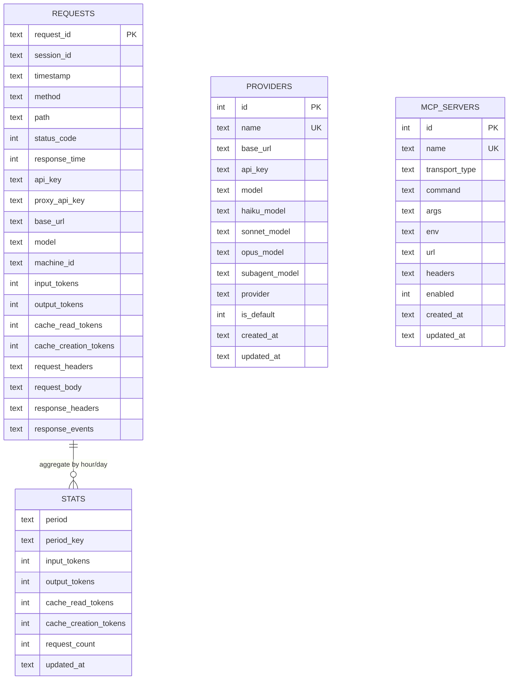

# proxy-core / 数据层

## 本文档覆盖的源文件

- `apps/proxy-core/src/utils/db.ts`
- `apps/proxy-core/src/utils/request-writer.ts`
- `apps/proxy-core/src/utils/migrate-files-to-db.ts`

## 单例 DB

`utils/db.ts`。文件级私有变量：

- `dbPath: string | null`——由 `configureDbPath(absPath)` 设置（`server/index.ts:13-15` 在 loadConfig 后立即设）
- `db: Database.Database | null`——首次 `initDatabase()` 时创建

`initDatabase()` 幂等：已初始化则直接返回。首次会：

1. 用 `dbPath || path.join(logsDir, 'proxy.db')` 作为绝对路径
2. `mkdirSync` 确保父目录存在
3. `new Database(resolvedPath)`
4. `PRAGMA journal_mode = WAL`（并发读友好）
5. `PRAGMA synchronous = NORMAL`（写延迟合理，掉电容忍）
6. 建 `schema_version` 表 → 查当前 version → 逐版应用迁移

`closeDatabase()`：Fastify `onClose` 钩子调用（`proxy.ts:170-173`）。

`getDatabase()`：未 init 抛错，供 handler 中同步查询。

## Schema 迁移


`initDatabase()` 中的 4 个 `if (currentVersion < N)` 顺序应用，每次成功后 `INSERT OR REPLACE INTO schema_version` 更新版本号。冷启动新库会一次跑完 v1→v4；旧库按需增量。

### v1：`applySchemaV1`（`db.ts:134-210`）

建两张表 + 索引。

**`requests` 表**（每次请求一行）：

| 字段 | 类型 | 含义 |
|---|---|---|
| id | INTEGER PK AUTOINCREMENT | 内部 ID |
| request_id | TEXT UNIQUE NOT NULL | 云端 `x-request-id` 或 nanoid |
| session_id | TEXT NOT NULL | `x-claude-code-session-id` |
| timestamp | TEXT NOT NULL | ISO |
| method | TEXT NOT NULL | POST/GET/... |
| path | TEXT NOT NULL | `/v1/messages` 等 |
| status_code | INTEGER NOT NULL | HTTP 状态 |
| response_time | INTEGER NOT NULL | 毫秒 |
| api_key | TEXT | 客户端原始 key |
| proxy_api_key | TEXT | 实际转给上游的 key |
| base_url | TEXT | 上游 origin |
| model | TEXT | 转发后的 model |
| input_tokens | INTEGER | 提取自 message_delta.usage |
| output_tokens | INTEGER | |
| cache_read_tokens | INTEGER | |
| cache_creation_tokens | INTEGER | |
| request_headers | TEXT | JSON |
| request_body | TEXT | JSON |
| response_headers | TEXT | JSON |
| response_events | TEXT | JSON（SSE events 数组） |
| completed_at | TEXT | ISO |
| closed_at | TEXT | ISO（预留） |
| error | TEXT | 错误串 |
| created_at | TEXT DEFAULT CURRENT_TIMESTAMP | |

**索引**（`db.ts:166-190`）：

- `idx_requests_session (session_id, timestamp DESC)` — 会话聚合查询
- `idx_requests_time (timestamp DESC)` — 全局时间序
- `idx_requests_status (status_code)` — 错误筛选
- `idx_requests_path (path)`
- `idx_requests_api_key (api_key)`
- `idx_requests_proxy_api_key (proxy_api_key)`
- `idx_requests_base_url (base_url)`
- `idx_requests_model (model)`

**`stats` 表**（预聚合）：

| 字段 | 类型 | 含义 |
|---|---|---|
| id | INTEGER PK AUTOINCREMENT | |
| period | TEXT NOT NULL | `'hourly'` / `'daily'` |
| period_key | TEXT NOT NULL | 时间桶键，见下文 |
| input_tokens | INTEGER DEFAULT 0 | SUM |
| output_tokens | INTEGER DEFAULT 0 | |
| cache_read_tokens | INTEGER DEFAULT 0 | |
| cache_creation_tokens | INTEGER DEFAULT 0 | |
| request_count | INTEGER DEFAULT 0 | |
| updated_at | TEXT DEFAULT CURRENT_TIMESTAMP | |
| UNIQUE(period, period_key) | | |

`period_key` 格式：

- hourly：`YYYY-MM-DD-HH`（UTC）
- daily：`YYYY-MM-DD`（本地时区 UTC+8，见 [stats.md](./stats)）

### v2：`applySchemaV2`（`db.ts:68-86`）

建 `providers` 表 + `idx_providers_name` 唯一索引。字段见 [providers.md](./providers)。

### v3：`applySchemaV3`

`PRAGMA table_info(providers)` 找 `is_default` 列；缺则 `ALTER TABLE ADD COLUMN is_default INTEGER NOT NULL DEFAULT 0`。

### v4：`applySchemaV4`

SQLite 不能直接改列约束。检测 `base_url / api_key / model` 是否仍为 NOT NULL，是则：

```sql
CREATE TABLE providers_new (...允许 NULL 的字段...);
INSERT INTO providers_new SELECT ...;
DROP TABLE providers;
ALTER TABLE providers_new RENAME TO providers;
CREATE UNIQUE INDEX idx_providers_name ON providers(name);
```

条件触发，重复运行安全。

### v5：`applySchemaV5`

两步：

1. **`machine_id` 列**：`PRAGMA table_info(requests)` 检测 `machine_id` 列是否存在，缺失则 `ALTER TABLE requests ADD COLUMN machine_id TEXT` + 创建索引 `idx_requests_machine_id`
2. **`mcp_servers` 表**：

```sql
CREATE TABLE IF NOT EXISTS mcp_servers (
  id INTEGER PRIMARY KEY AUTOINCREMENT,
  name TEXT UNIQUE NOT NULL,
  transport_type TEXT NOT NULL,    -- 'stdio' | 'sse' | 'streamable-http'
  command TEXT,                     -- stdio transport 的命令
  args TEXT,                        -- JSON array string
  env TEXT,                         -- JSON object string
  url TEXT,                         -- HTTP transport 的 URL
  headers TEXT,                     -- JSON object string (auth headers)
  enabled INTEGER NOT NULL DEFAULT 1,
  created_at TEXT DEFAULT CURRENT_TIMESTAMP,
  updated_at TEXT DEFAULT CURRENT_TIMESTAMP
);
CREATE UNIQUE INDEX IF NOT EXISTS idx_mcp_servers_name ON mcp_servers(name);
```

## ER 图



`STATS` 与 `REQUESTS` 无外键，靠 `stats-aggregator.ts` 定时 UPSERT 维持一致性。`PROVIDERS` 独立表，`REQUESTS.base_url` 只是快照，不是 FK。`MCP_SERVERS` 独立表，与 `PROVIDERS` 无关联——MCP server 是 tool provider，不是 API provider。

## `request-writer.ts` 三大函数

### `saveRequestDB(sessionId, requestId, data)`

`request-writer.ts:57-104`。`INSERT OR REPLACE INTO requests` 全字段。

- `response_time` 现算：`completedAt - timestamp`（毫秒）
- `usage` 通过 `extractTokenUsage(events)` 拿：找 `type === 'message_delta'` 的 event，取 `.usage`
- 所有 JSON 字段：`data.xxx ? JSON.stringify(data.xxx) : null`
- `INSERT OR REPLACE`：若同 `request_id` 已存在（比如 SSE 完成后覆盖前面写的空占位），直接替换。目前实际上 `proxy.ts` 只在响应完成时调用一次，占位仅在内存中

### `loadRequestDB(compositeId)`

`request-writer.ts:107-149`。`compositeId = sessionId + ':' + requestId`。用第一个 `:` 拆分，然后：

```sql
SELECT * FROM requests WHERE request_id = ? AND session_id = ?
```

行不存在抛 `Error(Request not found: ...)`。返回值反向组装：`request_headers` 等字段 `JSON.parse` 回对象。

### `listRequestDB(limit = 1000)`

`request-writer.ts:152-185`。`ORDER BY timestamp DESC LIMIT ?`。只 SELECT 摘要列（不含 headers/body/events），返回 `RequestSummary[]`。`usage` 字段：只要 `input_tokens || output_tokens` 非空就构造 usage 对象。

### `cleanOldRequestsDB(daysToKeep = 7)`

`request-writer.ts:189-200`。`daysToKeep <= 0` 直接 return。否则：

```sql
DELETE FROM requests WHERE timestamp < ?
```

`cutoff = now - daysToKeep * 86400000`（ISO 串比较）。**每次业务请求都会调**（`proxy.ts:233`）——SQLite 对 timestamp 索引 DELETE 微秒级，可以承受。

## `extractTokenUsage`

`request-writer.ts:50-54`。极简：

```ts
const messageDelta = events.find(e => e?.type === 'message_delta')
return messageDelta?.usage
```

`message_delta` 是 Anthropic Messages API 最终事件，`usage` 里含四个 Token 字段：`input_tokens / output_tokens / cache_read_input_tokens / cache_creation_input_tokens`。

**JSON 分支不适用**：JSON 响应体作为单一 event 直接 push（`proxy.ts:302`），`type` 字段可能不是 `message_delta`——所以 JSON 错误响应通常无 usage，写库时也是 null。

## 一次性迁移脚本 `migrate-files-to-db.ts`

历史上请求以 JSON 文件存 `logs/requests/<sessionId>/req-<requestId>.json`。此脚本一次性把它们导入 SQLite：

- `REQUESTS_DIR = path.resolve('../../logs/requests')`（相对 `packages/core` 的旧路径——路径已过时，需要在 `dist/utils` 下手动运行时会失效）
- `DB_PATH = path.resolve('../../logs/proxy.db')`
- 遍历 sessionId 目录 → `req-*.json` 文件 → 解构字段 → 事务批量 `INSERT OR IGNORE`

`INSERT OR IGNORE` 让重复运行安全。**当前项目已切到 SQLite 直写**（`saveRequestDB`），此脚本不再需要，仅供历史迁移参考。文件底部 `migrateFilesToDatabase().then(...)` 是自动执行块，直接 `node dist/utils/migrate-files-to-db.js` 即跑。
