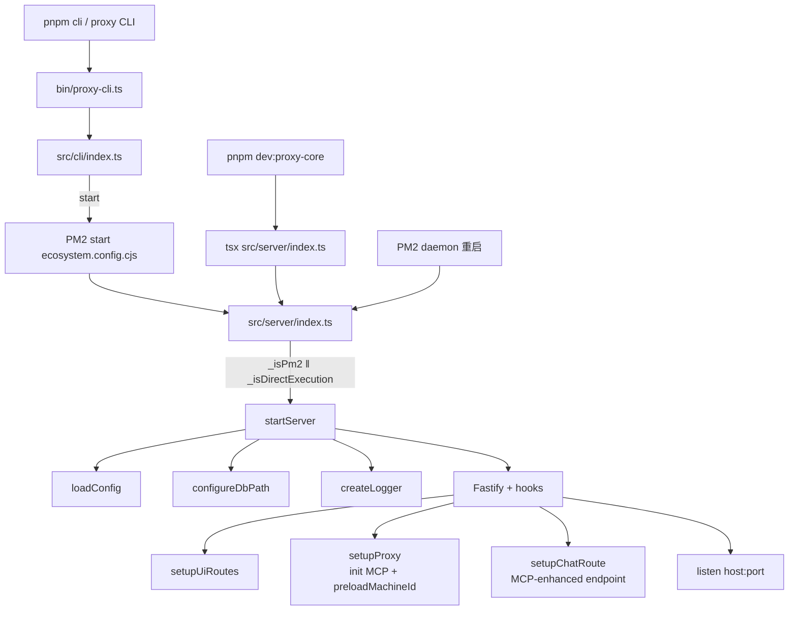
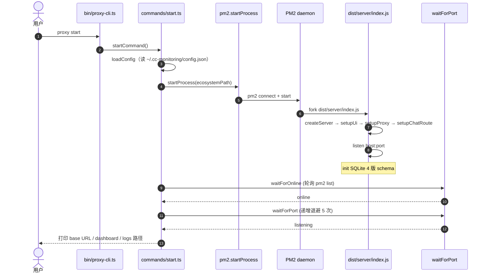

# proxy-core / 启动链

## 本文档覆盖的源文件

- `apps/proxy-core/bin/proxy-cli.ts`
- `apps/proxy-core/src/cli/index.ts`
- `apps/proxy-core/src/server/index.ts`
- `apps/proxy-core/src/utils/paths.ts`
- `apps/proxy-core/src/utils/esm-dirname.ts`
- `apps/proxy-core/ecosystem.config.cjs`

## 三条入口

`proxy-core` 有三种被启动的方式，都最终走到 `startServer()`：



## `bin/proxy-cli.ts`

`apps/proxy-core/bin/proxy-cli.ts:1-3`：

```ts
#!/usr/bin/env node
import '../dist/cli/index.js'
```

只有两行：加 shebang 让它可直接执行，然后 side-effect import 编译产物。`package.json` 的 `bin` 字段指向 `./dist/cli/index.js`，全局装包（`npm i -g @cc-monitoring/cli-core`）后终端有 `proxy` 命令。

## `src/cli/index.ts` — Commander 注册

`apps/proxy-core/src/cli/index.ts:1-80`。核心结构：

- 顶层 `program`：`name('proxy')`、`version('1.0.0')`、全局参数 `-c, --config <path>`
- `preAction` hook（`cli/index.ts:20-25`）：如果传了 `--config`，用 `path.resolve` 得到绝对路径调用 `setConfigPathOverride`，供后续 `loadConfig` 命中
- 8 条显式命令：`start / stop / status / logs / config / reload / test / ui`（详见 [cli.md](./cli.md)）
- 1 条隐藏命令：`clean-requests`（`cli/index.ts:63-78`），带 `--days <days>` 参数（默认 7），动态 import `cleanOldRequestsDB` 清 SQLite 老数据

命令 action 从 `commands/<name>.ts` 导入，保持文件级模块化。

## `src/server/index.ts` — 服务端引导

`apps/proxy-core/src/server/index.ts:11-42`：

```ts
export async function createServer(): Promise<FastifyInstance> {
  const config = await loadConfig()
  if (config.storage?.path) configureDbPath(config.storage.path)
  const logger = createLogger(config.logging)

  const fastify = Fastify({ logger, trustProxy: true })
  fastify.register(requestIdMiddleware)
  await setupUiRoutes(fastify)        // 必须先于 setupProxy，否则 /ui/* 会被 /v1/* 通配
  await setupProxy(fastify, config.proxy)
  await setupChatRoute(fastify, config.proxy)  // MCP-enhanced chat endpoint
  return fastify
}

export async function startServer(): Promise<void> {
  const config = await loadConfig()
  const server = await createServer()
  await server.listen({ port: config.server.port, host: config.server.host })
}
```

### 注册顺序为什么重要

`setupProxy` 内部注册 `fastify.all('/v1/*', ...)`（`proxy.ts:178`）。Fastify 的路由匹配按注册顺序，先注册的先命中。`setupUiRoutes` 里既有 `/ui`、`/ui/api/*`，也有 `/ui/*`（静态资源，`ui-route.ts:398-404`）。若顺序颠倒，静态资源的 wildcard 可能会吞掉 `/v1/*` 之外的路径——因此 `server/index.ts:24` 有明确注释 `UI routes registered BEFORE proxy`。

### `trustProxy: true`

信任反向代理头（如 `X-Forwarded-For`）。用户可能把 proxy-core 再套一层 nginx，这样 `request.ip` 才能反映真实客户端。

### `requestIdMiddleware` 提前注册

`middleware/request-id.ts` 通过 `onRequest` hook 给每个请求分配 `request.id`。放在最外层让所有日志与后续 handler 都用同一 ID（Fastify 默认自己会生成 UUID，本项目替换为 `nanoid(12)` 或客户端提供的 `x-request-id`）。

## ESM + PM2 双重入口守卫

`apps/proxy-core/src/server/index.ts:42-60`：

```ts
const _isPm2 = process.env.pm_id !== undefined || process.env.NODE_APP_INSTANCE !== undefined
const _currentModuleUrl = getCurrentModuleUrl()   // wraps import.meta.url
const _mainModulePath = process.argv[1] ? path.resolve(process.argv[1]) : ''
const _mainModuleUrl = _mainModulePath ? `file://${_mainModulePath}` : ''
const _isDirectExecution = _currentModuleUrl === _mainModuleUrl

if (_isPm2 || _isDirectExecution) {
  startServer().catch(err => { console.error('Server start failed:', err); process.exit(1) })
}
```

两个场景都会自动启动：

- **PM2 fork 模式**：PM2 会把 `process.argv[1]` 改成 `ProcessContainerFork.js` 包装脚本，导致 `import.meta.url === main module url` 判定失败；用 `pm_id` / `NODE_APP_INSTANCE` 环境变量补检测
- **直接执行**（`tsx src/server/index.ts` 或 `node dist/server/index.js`）：URL 相等判定成立

第三种情况（只 import 不执行，例如测试）两条判定都不成立，`startServer` 不会自动跑。

## 数据目录锚点 `paths.ts`

`apps/proxy-core/src/utils/paths.ts`：

```ts
export const dataDir = path.join(os.homedir(), '.cc-monitoring')
export const logsDir = path.join(dataDir, 'logs')
```

- 全局 npm/pnpm 安装后 `process.cwd()` 无法预测，锚定到用户主目录才可靠
- CLI 全局 `--config` → `setConfigPathOverride` → 存到模块级变量 `configPathOverride`
- `getConfigPath()` 优先级：override > `process.env.CONFIG_PATH` > `path.join(dataDir, 'config.json')`
- `ensureDataDirs()` 首次运行时 `mkdirSync(logsDir, { recursive: true })`

## ecosystem.config.cjs

`apps/proxy-core/ecosystem.config.cjs`（本项目唯一的 CommonJS 文件）：

```js
const dataDir = process.env.CC_DATA_DIR || path.join(os.homedir(), '.cc-monitoring')
const configPath = process.env.CONFIG_PATH || path.join(dataDir, 'config.json')

module.exports = {
  apps: [{
    name: 'cc-monitoring',
    script: path.join(__dirname, 'dist/server/index.js'),
    cwd: dataDir,
    instances: 1,
    exec_mode: 'fork',       // 必须 fork：ESM 与 cluster 不兼容
    autorestart: true,
    watch: false,
    max_memory_restart: '200M',
    env: { NODE_ENV: 'production', CONFIG_PATH: configPath },
    env_development: { NODE_ENV: 'development', CONFIG_PATH: configPath },
    log_date_format: 'YYYY-MM-DD HH:mm:ss Z',
    error_file: path.join(logsDir, 'error.log'),
    out_file: path.join(logsDir, 'out.log'),
    merge_logs: true
  }]
}
```

- `script` 用 `path.join(__dirname, ...)`：ecosystem 无论从哪个 cwd 调都能找到编译产物
- `cwd: dataDir`：让相对路径日志/DB 落到用户目录，不污染项目工程
- `exec_mode: fork`：cluster 模式基于 `worker_threads` 子进程复制 `main`，ESM 会在 worker 里报 `Cannot use import statement`；fork 直接 spawn Node，安全
- `.cjs` 扩展名：根 `package.json` `type: "module"` 让 `.js` 变 ESM；PM2 是 CJS，必须 `.cjs` 让 Node 按 CJS 加载

更多细节 → [pm2.md](./pm2.md)。

## 冷启动时序



`start.ts` 用 `ora` spinner 打印 6 步进度（Loading config → Locating PM2 config → Starting → Waiting online → Verifying port → Summary），失败时 spinner 变红并给出日志路径提示。
