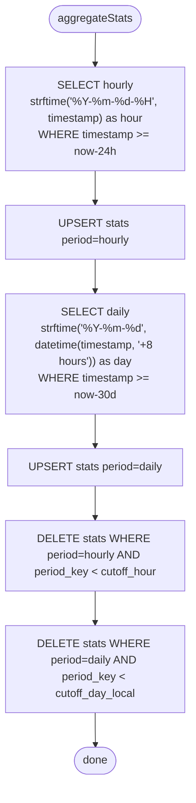

# proxy-core / 统计与历史

## 本文档覆盖的源文件

- `apps/proxy-core/src/utils/stats-aggregator.ts`
- `apps/proxy-core/src/utils/status-history.ts`
- `apps/proxy-core/src/server/ui-route.ts:144-175`（stats REST 端点）

## 三种「统计」

| 类型 | 数据源 | 更新频率 | 生命周期 | 用途 |
|---|---|---|---|---|
| 预聚合 stats | SQLite `stats` 表 | 5 分钟 | 持久（30d/24h 内） | 面板柱状图（近 24h / 近 30d） |
| 今日实时 stats | 直接查 `requests` | 每次请求 | 无（现算） | 面板今日 5 张卡 |
| status 历史 | 内存 `StatusHistoryStore` | 10 秒 | 进程重启即丢 | 面板 CPU/内存折线图 |

## 预聚合：`aggregateStats`

`utils/stats-aggregator.ts:18-105`。触发时机：

- 服务启动时立即跑一次（`proxy.ts:163-167`）
- 之后 `setInterval(aggregateStats, 300_000)`（5 分钟）

流程：



### 时区处理

- **hourly**：直接用 `strftime('%Y-%m-%d-%H', timestamp)`，SQLite 默认 UTC。`period_key` 是 UTC 桶键。前端拿到后**用本地时区显示**（`apps/proxy-cli/src/components/StatsBarChart.tsx:22-44`），需要把本地当前小时 → UTC 键再查
- **daily**：`datetime(timestamp, '+8 hours')` 硬编码 +8 时区（北京时间）。`period_key` 是本地日期串。前端直接用本地日期查

**⚠️ 硬编码 +8 的问题**：其他时区用户的「今日」边界不准。今日实时统计（下节）通过 `since` 参数由客户端传本地零点绕过了这个问题；但预聚合 daily 仍用固定偏移。

### UPSERT 语义

用 `INSERT OR REPLACE`（依 UNIQUE(period, period_key)）。任何一条聚合行既可能是首次插入，也可能是覆盖旧值。

### 清理

- hourly：超出 24h 窗口的 period_key 全删
- daily：超出 30d 窗口（本地日期）全删

清理是当次 aggregate 内的最后步骤，与新数据 upsert 在同一个逻辑事务外——但因为 SQLite 语句默认自动提交且 WAL，功能等价。

### 内置 `strftime` 辅助

`stats-aggregator.ts:194-208`。JS 端等价函数用于计算 `hourlyCutoff` 键：

```ts
function strftime(format, date) {
  if (format === '%Y-%m-%d-%H') return `${y}-${mm}-${dd}-${hh}`
  if (format === '%Y-%m-%d') return `${y}-${mm}-${dd}`
}
```

## 读取：`getStatsData`

`stats-aggregator.ts:108-150`。

- `SELECT * FROM stats WHERE period='hourly' ORDER BY period_key DESC LIMIT 24`
- `SELECT * FROM stats WHERE period='daily' ORDER BY period_key DESC LIMIT 30`
- `SELECT MAX(updated_at) as last_updated FROM stats`

返回：

```ts
{
  hourly: { "2026-07-04-08": { input_tokens, output_tokens, cache_read_tokens, cache_creation_tokens, request_count }, ... },
  daily:  { "2026-07-04": { ... }, ... },
  lastUpdated: "2026-07-04T08:00:00.000Z"
}
```

**注意**：hourly 键是 UTC，daily 键是本地。前端要用不同的 key 构造逻辑来查询。

## 今日实时：`getTodayStats(since)`

`stats-aggregator.ts:155-191`。参数 `since` 是 ISO 时间戳（客户端本地零点）。绕过预聚合表，直接查 `requests`：

```sql
SELECT
  SUM(input_tokens) input_tokens,
  SUM(output_tokens) output_tokens,
  SUM(cache_read_tokens) cache_read_tokens,
  COUNT(*) request_count
FROM requests
WHERE timestamp >= ?
```

外加按 model 计数：

```sql
SELECT model, COUNT(*) count
FROM requests
WHERE timestamp >= ? AND model IS NOT NULL AND model != ''
GROUP BY model ORDER BY count DESC
```

返回 `TodayStats`：

```ts
{
  input_tokens, output_tokens, cache_read_tokens, request_count,
  models: { 'claude-sonnet-4-6': 42, 'auto': 3, ... }
}
```

前端在挂载 + 收到新请求 WebSocket 消息时都会重新 fetch（`hooks/useWebSocketData.ts:139-152`）。

## REST 端点

`ui-route.ts:144-175`：

```ts
GET /ui/api/stats                        // → getStatsData()
GET /ui/api/stats/today?since=<ISO>      // → getTodayStats(since)
```

`since` 缺失或 `Number.isNaN(new Date(since).getTime())` 时，服务端用**服务器本地零点**兜底（`setHours(0,0,0,0)`）。所以客户端总应显式传本地零点 ISO——`apps/proxy-cli/src/api/index.ts:52-55` 就是这么做的。

## 内存态：`StatusHistoryStore`

`utils/status-history.ts`：

```ts
export interface StatusDataPoint {
  timestamp: number   // Unix ms
  cpu: number
  memory: number      // bytes
}

export class StatusHistoryStore {
  private data: StatusDataPoint[] = []
  private maxPoints: number = 720  // 注释写 1h × 60min × 12（5s 间隔），实际使用 10s → 约 2h

  push(point): void
  getHistory(durationMs = 3600000): StatusDataPoint[]
}

export const statusHistory = new StatusHistoryStore()
```

单例。`push` 超容量时 `slice(-maxPoints)` 裁掉最旧。`getHistory` 按 `now - duration` 截断。

**采样源**：`ui-route.ts:353-360` 的 `handleDataStream` 里，每 10 秒执行 `statusHistory.push({ timestamp: Date.now(), cpu, memory })`。除此之外没有其它写入点——**只有面板 WebSocket 打开时才在采样**。

**副作用**：如果面板长时间未打开，历史图会空白。REST `GET /ui/api/status/history` 仍能返回数据，但只包含近期面板打开时段。

## 前端展现

- 5 张实时卡：`TodayStatsCards`（输入/输出/缓存 Tokens + 请求次数 + 模型使用）— 见 [../proxy-cli/components-stats.md](../proxy-cli/components-stats)
- 24h/30d 柱状图：`StatsBarChart`（Toggle Hour/Day）
- CPU/内存折线：`StatusLineChart` × 2（`StatusPanel` 内）

## 相关文档

- 数据库表定义 → [data-layer.md](./data-layer)
- 面板消费 → [../proxy-cli/data-hooks](../proxy-cli/data-hooks)
- 面板组件 → [../proxy-cli/components-stats](../proxy-cli/components-stats) / [../proxy-cli/components-status](../proxy-cli/components-status)
