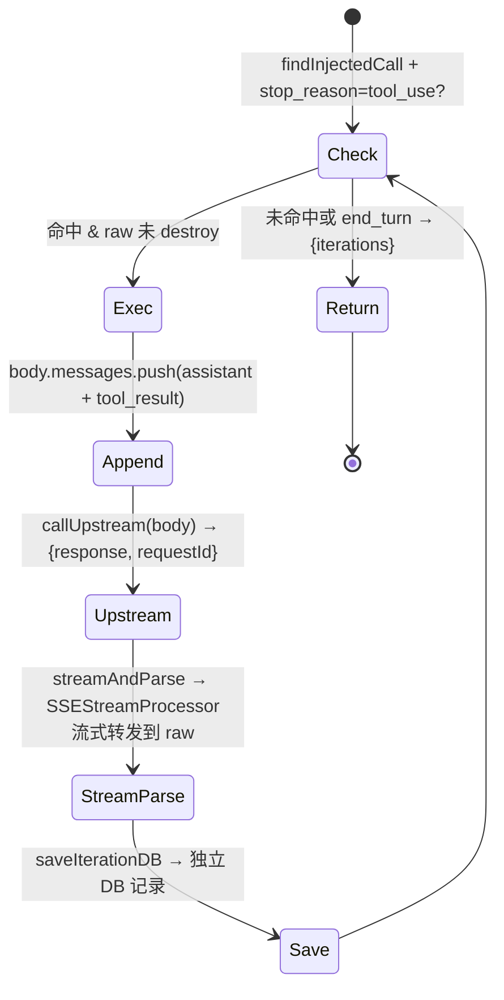

# proxy-core / Tool 注入 + MCP 动态 Tool

## 本文档覆盖的源文件

- `apps/proxy-core/src/tools/index.ts`
- `apps/proxy-core/src/tools/types.ts`
- `apps/proxy-core/src/tools/registry.ts`
- `apps/proxy-core/src/tools/curl.tool.ts`
- `apps/proxy-core/src/tools/probe.tool.ts`
- `apps/proxy-core/src/tools/mcp-bridge.ts`
- `apps/proxy-core/src/utils/tool-injector.ts`
- `apps/proxy-core/src/utils/inject-loop.ts`
- `apps/proxy-core/src/utils/sse-stream-processor.ts`
- `apps/proxy-core/src/utils/sse-writer.ts`
- `apps/proxy-core/src/utils/mcp-manager.ts`
- `apps/proxy-core/src/utils/mcp-db.ts`
- `apps/proxy-core/src/server/chat-route.ts`

## 概念

「Tool 注入」= 在 proxy 转发前把一些 **tool** 追加到请求体的 `tools` 数组末尾。上游模型可能调用这些 tool；proxy 检测到命中后**在后端本地执行 exec**，把结果作为 `tool_result` 追加到对话，然后再次调用上游，直到模型给出最终文本。

**注入路径分工**：

| 路径 | 注入方式 | 说明 |
|---|---|---|
| `/v1/*` | 无注入 | 纯代理，不做任何请求体修改 |
| `/api/chat` | `injectMcpTools` | 仅注入 MCP 动态 tool（不含 probe/curl） |

对客户端而言，`/api/chat` 的 SSE 响应看起来像一次正常的流式响应；实际上 proxy 可能已经代替客户端完成了若干轮 MCP tool 调用，续接到同一 SSE 连接上。

设计目标见 `docs/thinks/tool-plugin-injection-plan.md`（用户历史设计文档）。

## 四层结构

```
mcp-manager + mcp-db → MCP server 连接管理（发现 tool）
mcp-bridge           → MCP tool → InjectableTool 转换（name prefix + exec 代理）
tools/registry.ts    → 注册表 ALL_TOOLS（静态） + mcpManager.getMcpTools()（动态）
tools/*.tool.ts      → 单个 tool 定义（name + description + input_schema + enabled + exec）
utils/tool-injector  → injectMcpTools：在 /api/chat 发送前追加 MCP tools
utils/inject-loop    → 命中后的内部循环（3 种：SSE buffered / SSE streaming / JSON）
sse-stream-processor → 流式 SSE 增量解析 + 转发
utils/sse-writer     → 合成 SSE 回写（mock / 旧版 buffered loop）
```

## `InjectableTool` 接口

`tools/types.ts:16-30`：

```ts
export interface InjectableTool {
  name: string                          // 唯一，注入 + 命中检测 + tool_result 配对
  description: string                   // 给模型看（决定何时调用）
  input_schema: ToolInputSchema         // JSON Schema，type=object
  enabled: boolean                      // 是否启用
  exec(input: any): string | Promise<string>  // 本地执行，返回字符串给上游
}
```

三件套 `name / description / input_schema` 会随 `injectTools` 写进请求体的 `tools` 数组；`enabled` 和 `exec` 是本地元数据，**不进入请求体**。

## 已内置的 2 个 tool

### `probeTool`（`tools/probe.tool.ts`）

```ts
{
  name: '__inject_probe',
  description: '当 user 消息含 __PROBE__ 时必须调用此 tool 回显请求',
  input_schema: { echo: string, required: ['echo'] },
  enabled: false,   // 默认关
  exec(input) { return 'Probe executed. Received echo: "<...>". Now answer directly; do NOT call __inject_probe again.' }
}
```

PoC 验证工具。把 `enabled` 改成 `true` 后端到端跑一遍：

- Claude Code 发含 `__PROBE__` 的 user message
- proxy 把 `__inject_probe` 追加到 tools
- 上游模型看到描述后决定调用它
- proxy 捕获 tool_use → 本地跑 exec → 生成 tool_result → 再调上游
- 上游模型此时应给出正式文本回答（描述里明确要求「不要再次调用」）
- proxy 合成 SSE 把文本回给客户端

### `curlTool`（`tools/curl.tool.ts`）

```ts
{
  name: 'curl_proxy',
  description: 'Use this tool to fetch data from a local service or API...',
  input_schema: { url: string, method?: 'GET'|'POST', body?: string, required: ['url'] },
  enabled: true,   // 默认开
  async exec(input) {
    const response = await fetch(url, { method, headers: { 'Content-Type': 'application/json' }, body })
    const data = await response.text()
    return `Successfully fetched from ${url}:\n\n${data.substring(0, 2000)}`
  }
}
```

给模型一个能拉本地服务的能力（本机 API 探测、开发调试）。响应文本截断到 2000 字符，避免灌爆上下文。

## 注册表 `registry.ts` — 静态 + 动态

```ts
const ALL_TOOLS: InjectableTool[] = [probeTool, curlTool]  // 静态本地 tool

function allKnownTools(): InjectableTool[] {
  return [...ALL_TOOLS, ...mcpManager.getMcpTools()]  // 动态合并 MCP tools
}

export function enabledTools(): InjectableTool[]  { return allKnownTools().filter(t => t.enabled) }
export function hasEnabledTools(): boolean        { return allKnownTools().some(t => t.enabled) }
export function findEnabledTool(name): InjectableTool | undefined
```

新增本地 tool：`tools/xxx.tool.ts` 导出 `InjectableTool` → 在 `ALL_TOOLS` 添一行 → 决定 `enabled` 初值。

MCP tool 通过 `mcpManager.getMcpTools()` 动态合并——连接时发现，断开时消失。每次 `enabledTools()` / `hasEnabledTools()` / `findEnabledTool()` 调用都含当前已连接 MCP server 的 tool。

`tools/index.ts` 是 barrel：`export { enabledTools, hasEnabledTools, findEnabledTool } from './registry.js'` + `export type { InjectableTool, ToolInputSchema } from './types.js'`。

## MCP Tool Bridge (`mcp-bridge.ts`)

`mcpToolToInjectable(mcpTool, serverName, client)` 把 MCP SDK 发现的 tool 转为 `InjectableTool`：

```ts
const prefixedName = `mcp__${serverName}__${mcpTool.name}`

return {
  name: prefixedName,
  description: mcpTool.description || '',
  input_schema: mcpTool.inputSchema,
  enabled: true,
  async exec(input) {
    const result = await client.callTool({ name: mcpTool.name, arguments: input })  // 原始 name，无 prefix
    // 从 result.content[] 提取 text 块，join 为字符串返回
  }
}
```

**Name prefix 设计**：`mcp__<serverName>__<toolName>` 避免 MCP tool 与本地 tool（probe/curl）name 冲突。`exec()` 调 `client.callTool` 时用**原始 name**（无 prefix），因为 MCP server 只认自己的 name。

**exec 代理**：不是本地执行，而是远程调 MCP server。MCP server 返回 `content[]`（text 块 + 其它块），bridge 把 text 块 join 成字符串返回给 inject loop。

## `injectMcpTools(body)` — MCP-only 注入

`utils/tool-injector.ts:14-31`。仅用于 `/api/chat`。

```ts
if (!Array.isArray(body?.tools)) {
  body.tools = []  // 裸请求也能用 MCP tool — 自动创建 tools 数组
}

const injected: string[] = []
for (const tool of mcpManager.getMcpTools()) {  // 仅 MCP tools，不含 probe/curl
  if (!tool.enabled) continue
  if (body.tools.some(t => t?.name === tool.name)) continue   // 幂等
  body.tools.push({ name: tool.name, description: tool.description, input_schema: tool.input_schema })
  injected.push(tool.name)
}
return injected
```

### 关键约束

- **仅注入 MCP tools**：`mcpManager.getMcpTools()` 只返回当前已连接 MCP server 的 tool，不含 probe/curl。这是 `/api/chat` 的设计决策——MCP tool 是用户自配置的业务 tool，probe/curl 是开发调试 tool
- **裸请求也能注入**：`body.tools` 不存在时自动创建空数组，让没有 tools 字段的请求也能使用 MCP tool（`/v1/*` 的旧 `injectTools` 要求 `body.tools` 非空才注入）
- **追加到末尾**：Anthropic 按 `tools → system → messages` 顺序算前缀哈希，追加末尾只让 tools 段末端缓存失效
- **幂等**：已存在同名 tool 就跳过
- **仅写三件套**：exec/enabled 是本地状态，模型不需要知道

## `hasEnabledTools()` 是 `/v1/*` 的零影响保障

若 registry 中所有 tool 的 `enabled: false`（例如 probe 默认关、MCP server 断连），`hasEnabledTools()` return false，`/v1/*` 的转发路径完全等同纯代理——**零性能影响**。

但 `/api/chat` **始终调用 `injectMcpTools`**，不依赖 `hasEnabledTools()` 判断。即使当前无 MCP tool 连接，`injectMcpTools` 也只是返回空数组（`injected = false`），代码正常执行。

## 三种内部循环

### `runInjectLoop`（SSE buffered — 旧版）

`inject-loop.ts:129-159`。用于旧版 `/v1/*` 注入路径（现已移除）。保留供参考。

流程：缓冲上游 SSE 全文 → 解析 → 检测命中 → 循环（exec tool → 追加对话 → callUpstream）→ 合成 SSE 回写。

返回 `{ text, iterations, stoppedByLimit }`。`text` 是最终模型输出，由 `writeTextAsSSE` 合成到客户端。

### `runStreamingInjectLoop`（SSE streaming — `/api/chat` 用）

`inject-loop.ts:175-227`。**核心路径**——不缓冲，直接流式转发到同一 `reply.raw`。

```ts
export async function runStreamingInjectLoop(opts: {
  initialParsed: ParsedUpstream
  body: any
  callUpstream: (body) => Promise<{ response: Response, requestId: string }>
  streamAndParse: (response) => Promise<{ processor: SSEStreamProcessor, statusCode: number }>
  sessionId: string
  saveIterationDB: (requestId, processor, statusCode, requestBody) => Promise<void>
  raw: ServerResponse
  maxIterations?: number    // 默认 3
}): Promise<StreamingInjectLoopResult>
```

流程：



**与旧版 `runInjectLoop` 的核心区别**：

| | runInjectLoop（旧） | runStreamingInjectLoop（新） |
|---|---|---|
| 上游响应处理 | `await response.text()` 全量缓冲 | `SSEStreamProcessor` 流式转发 |
| 客户端看到 | 合成 SSE（仅 text，`writeTextAsSSE`） | 原始 SSE（thinking + text + tool_use） |
| DB 记录 | 原始 events 存第 1 条，loop 结果合并 | 原始 + 每次迭代独立记录 |
| 返回值 | `{ text, iterations }` | `{ iterations }`（text 已实时流到客户端） |
| 连接模式 | 缓冲完毕后一次性 `reply.raw.end()` | 同连接续接，`reply.raw.end()` 在最后 |
| 客户端断连检测 | 无 | `raw.destroyed` 每次迭代前检查 |

### `runJsonInjectLoop`（JSON — `/api/chat` 用）

`inject-loop.ts:244-277`。处理非流式 JSON 响应中的 tool_use。

```ts
export async function runJsonInjectLoop(opts: {
  initialBody: any
  requestBody: any
  callUpstream: (body) => Promise<any>  // 返回 parsed JSON body
  maxIterations?: number
}): Promise<JsonInjectLoopResult>
```

与 SSE streaming 版对称，但处理 parsed JSON response body 而非 SSE events。返回 `{ finalBody, iterations, stoppedByLimit }`。

### `blocksToAssistantContent`

`inject-loop.ts:99-106`。三种 loop 共用——只把 `text` 和 `tool_use` 块转成 API 格式，**跳过 thinking 块**（Anthropic extended thinking 有 signature 校验）。

### `maxIterations = 3`

三种 loop 共用护栏：tool 描述可能诱导模型反复调用同一 tool。3 轮后强制退出。

## 缓冲检测 → 流式检测（`/api/chat` 用 SSEStreamProcessor）

`/v1/*` 不再有缓冲检测（纯代理）。`/api/chat` 的 SSE 路径统一处理：

1. **Phase 1**：`SSEStreamProcessor` 边转发原始 SSE 边增量解析，客户端实时收到与上游完全一致的流
2. **Stream end**：`processor.hasInjectedToolUse()` 检测命中（`stopReason === 'tool_use'` + `findInjectedCall` 找到注入 tool）
3. **Phase 2**（命中时）：发 `proxy_status` SSE 事件 + `runStreamingInjectLoop` 流式续接

**不再缓冲上游响应**——这是与旧版的关键区别。旧版用 `await response.text()` 全量缓冲再检测；新版用 `SSEStreamProcessor` 实时解析，stream end 后检测。客户端始终收到原始 SSE（零延迟）。

### SSEStreamProcessor

`sse-stream-processor.ts`：

```
SSEStreamProcessor
├── raw: ServerResponse              // reply.raw，用于转发 chunk
├── events: any[]                    // 解析出的 JSON 事件（供 DB 记录）
├── contentBlocks: Map<number, ParsedBlock>  // 增量累积的 content block 状态
├── stopReason: string               // 从 message_delta 捕获
├── usage: any                       // 从 message_delta 捕获
├── leftover: string                 // 跨 chunk 的不完整行缓冲
│
├── processChunk(chunk)              // raw.write(chunk) + 解析 data: 行 + processEvent
├── flushLeftover()                  // stream end 后处理残留行
├── processEvent(e)                  // 增量更新 contentBlocks/stopReason
├── getParsedUpstream()              // 从累积状态构建 ParsedUpstream
└── hasInjectedToolUse()             // stopReason=tool_use + findInjectedCall
```

`processEvent` 逻辑与 `parseUpstreamEvents` 完全一致，改为逐事件调用。跨 chunk 行边界通过 `leftover` 缓冲处理。

## 合成 SSE `sse-writer.ts`

`writeSSEEvent(raw, event)` 按 Anthropic 双行格式写：`event: <type>\ndata: <json>\n\n`。

`writeTextAsSSE(raw, text, messageId)` 生成一次完整的合法事件流：

```
message_start                       (usage 全 0，model 'auto')
content_block_start (text 块 0)
content_block_delta (text_delta → 一次性把全部文本吐出)
content_block_stop
message_delta (stop_reason: end_turn)
message_stop
```

`messageId` 由 proxy 自己生成（如 `msg_inject_<cloudRequestId>` / `msg_poc_<requestId>`）：合成流没有上游 id，全程用一致的假 id。

`shouldMock(body)`：`__MOCK__` PoC 触发词（详见 [proxy.md](./proxy.md#分支-1mock)）。

## 与前端的关系

前端**不知道** `/api/chat` 的 SSE 响应经历了几轮 tool 调用。请求历史面板里看到的是：

- `/v1/*` 请求：单条记录（原始请求 + events）
- `/api/chat` 请求：可能 1~N 条记录（第 1 条 = 原始 SSE，第 2~N 条 = inject loop 迭代）
- 所有记录共享同一 `sessionId`，通过 `compositeId = sessionId:requestId` 关联
- `response_events` 与客户端实际收到的一致（原始 SSE 透传）

`/api/chat` 的 inject loop 迭代独立记录到 DB——与旧版（合并到第 1 条）不同，面板可以看到每次 tool 调用的详情。

## 相关文档

- `/api/chat` 的 tool 注入流程 → [chat-api.md](./chat-api)
- `/v1/*` 纯代理路径 → [proxy.md](./proxy)
- MCP server 管理 → [ui-routes.md](./ui-routes#mcp-server-管理-api)
- 供应商 tier model → [providers.md](./providers)
