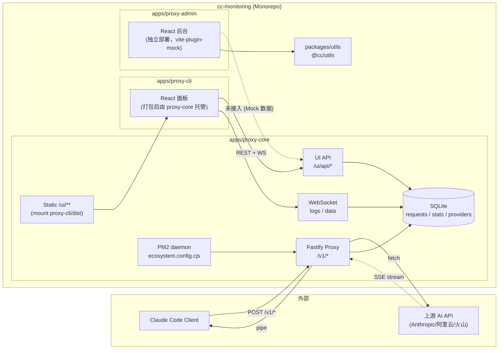

# 00. 项目总览

## 本文档覆盖的源文件

- `README.md`
- `package.json`
- `pnpm-workspace.yaml`
- `config.json`
- `tsconfig.base.json`
- `apps/proxy-core/package.json`
- `apps/proxy-cli/package.json`
- `apps/proxy-admin/package.json`
- `packages/utils/package.json`

## 项目定位

`cc-monitoring` 是「Claude Code 代理 + 监控系统」，同时解决两个问题：

1. **网络接入**：国内开发者无法直连 Anthropic API，需要一个可控的中转层
2. **可观测**：所有 Claude Code 请求/响应可以被记录、检索、对比、统计

它不是单一进程，而是一套 monorepo：**一个 Fastify 代理服务**（proxy-core）+ **两套 Web 面板**（proxy-cli / proxy-admin）+ **公共工具包**（packages/utils）。用户改一个 API endpoint 即可用上代理，同时获得请求历史、日志流、Token 统计、多供应商切换、系统管理等能力。

## Monorepo 结构

```
cc-monitoring/
├── apps/
│   ├── proxy-core/     # Fastify + PM2 + Commander CLI + SQLite（后端）
│   ├── proxy-cli/      # React 面板：状态/日志/请求/配置/供应商（Vite 打包，proxy-core 静态托管）
│   └── proxy-admin/    # React 后台：用户/供应商/日志/系统（独立 Vite 项目，目前 Mock 数据）
├── packages/
│   └── utils/          # 通用工具函数（@cc/utils）
├── docs/               # 本目录
├── config.json         # 根级运行时配置（如未使用 ~/.cc-monitoring/config.json）
├── logs/               # 日志与 SQLite 数据目录
├── pnpm-workspace.yaml # workspace 定义（apps/* + packages/*）
├── tsconfig.base.json  # 共享 TS 配置
└── package.json        # 根 script + 便捷 CLI 别名
```

`pnpm-workspace.yaml` 声明两个通配符：

```yaml
packages:
  - 'apps/*'
  - 'packages/*'
allowBuilds:
  better-sqlite3: true
  esbuild: true
  msw: true
```

`allowBuilds` 是 pnpm 8+ 的安全策略：仅允许列出的三个原生依赖执行安装脚本（`better-sqlite3` 编译 SQLite，`esbuild` 下载二进制，`msw` 生成 service worker）。

## 应用依赖图



关键连线说明：

- `proxy-core` 是唯一同时承载业务代理（`/v1/*`）与 UI 后端（`/ui/*`、WebSocket）的进程
- `proxy-cli` 构建产物 `dist/` 被 proxy-core 用 `@fastify/static` 挂在 `/ui/` 路径下（生产模式）
- `proxy-admin` 目前仍在使用 `vite-plugin-mock` 提供假数据，**尚未接入 proxy-core**，是独立的前端项目
- `packages/utils` 目前仅被 `proxy-admin` 通过 `workspace:^1.0.0` 引用

## 技术栈速查

| 层 | 技术 |
|---|---|
| 包管理 | pnpm 8+（workspace） |
| 语言 | TypeScript 5 严格模式 |
| Node | 18+，全局 `"type": "module"`（ESM） |
| 后端框架 | Fastify 4 |
| 后端进程管理 | PM2 5（fork 模式，ESM 兼容） |
| 数据库 | better-sqlite3（同步 API + WAL） |
| 配置校验 | Zod |
| 日志 | Pino + file-stream-rotator |
| WebSocket | 原生 `ws`（不走 `@fastify/websocket`，参见 [ui-routes.md](./proxy-core/ui-routes.md)） |
| 前端框架 | React 18 |
| 前端构建 | Vite 5 |
| proxy-cli 组件 | 原生 + Tailwind 4 + Recharts + Shiki + `@pierre/diffs` |
| proxy-admin 组件 | Ant Design 5 + axios |
| proxy-cli i18n | i18next（zh/en 6 命名空间） |
| proxy-admin mock | vite-plugin-mock + mockjs |
| 测试 | Jest（proxy-core） + Vitest（前端） |

## 三个应用的分工

| 维度 | proxy-core | proxy-cli | proxy-admin |
|---|---|---|---|
| 角色 | 后端 + 数据源 | 面向单机用户的仪表板 | 面向管理员的运营后台 |
| 部署 | PM2 守护 | 由 proxy-core 静态托管 | 独立 Vite 项目 |
| 数据 | SQLite 真实 | 从 proxy-core 拉真实数据 | 目前 Mock 数据 |
| UI 库 | 无 | 原生 + Tailwind | Ant Design 5 |
| 端口（开发） | 9527（默认） | 由 Vite 代理到 core（硬编码 3000） | 3000（默认，与 proxy-cli 反代目标撞车） |
| 主要用户操作 | CLI（`pnpm cli`）| 看请求/日志/状态、编辑配置、切供应商 | 管理用户/供应商/系统设置（规划中） |

## 数据流一览（详见 [02-request-flow.md](./02-request-flow.md)）

1. **业务请求**：Claude Code → `/v1/*` → proxy-core → 上游 → SSE 回流 → 客户端；同一次调用被写入 SQLite `requests` 表
2. **UI 只读**：proxy-cli 首次挂载走 REST（`/ui/api/status`、`/ui/api/requests` 等），随后订阅 `/ui/api/ws` 拿增量推送
3. **日志流**：proxy-cli 订阅 `/ui/api/logs/stream`，proxy-core 用 `fs.watch` 增量读取 Pino 日志文件
4. **配置修改**：proxy-cli 通过 `POST /ui/api/config` 保存（可选 Bearer 认证），必要时后端延迟 `pm2 reload`
5. **供应商切换**：proxy-cli 用 `POST /ui/api/providers` 全量写 SQLite `providers` 表；下一次业务请求命中 `resolveProxyTarget` 立即生效

## 关键设计决策

- **应用层转发而非透明代理**：Fastify 先解析 body，再 fetch 上游，SSE 用 `Readable.fromWeb().pipe(reply.raw)` 转发。原因见 [proxy-forwarding.md](./proxy-core/proxy-forwarding.md)
- **数据目录锚定 `~/.cc-monitoring`**：让全局 npm 安装、PM2 守护、CLI 一次性运行共用同一份 config 与数据，源于 `apps/proxy-core/src/utils/paths.ts`
- **ESM + PM2 桥接**：全局 `type: module` 会让 `.js` 变 ESM，PM2 是 CJS 包，故用 `createRequire(import.meta.url)` 加载 pm2，ecosystem 用 `.cjs` 扩展名
- **供应商部分覆盖**：`resolveProxyTarget` 允许 provider 只填 `base_url`、只填 `api_key`、只填 `model` 中的任意组合，未填字段回退到 config.json，详见 [providers.md](./proxy-core/providers.md)
- **stats 双通道**：预聚合表 `stats`（每 5 分钟刷新，兼顾 24h / 30d）+ 今日实时 `getTodayStats(since)`（按客户端本地零点查 `requests` 表），详见 [stats-and-history.md](./proxy-core/stats-and-history.md)
- **tool 注入的条件缓冲**：只有存在启用 tool 且当前请求是主对话（tools 非空）时才进入缓冲检测路径，未启用 tool 时代码路径与常规 SSE pipe 完全一致（零影响），详见 [tool-injection.md](./proxy-core/tool-injection.md)

## 相关文档

- 想马上跑起来 → [01-quickstart.md](./01-quickstart.md)
- 想理解一次请求的完整旅程 → [02-request-flow.md](./02-request-flow.md)
- 想深入后端 → [proxy-core/README.md](./proxy-core/README.md)
- 想改前端面板 → [proxy-cli/README.md](./proxy-cli/README.md)
- 想改管理后台 → [proxy-admin/README.md](./proxy-admin/README.md)
