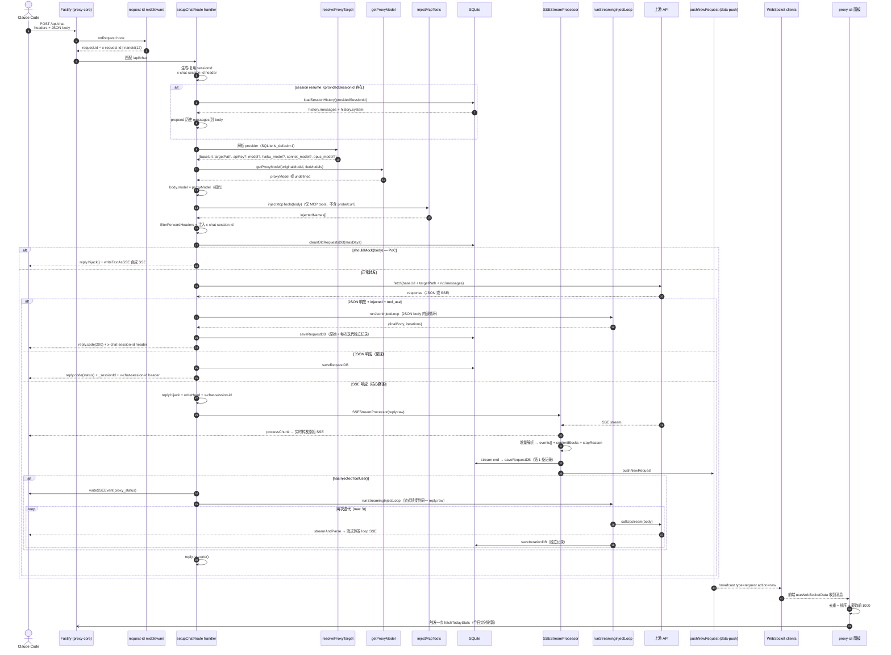
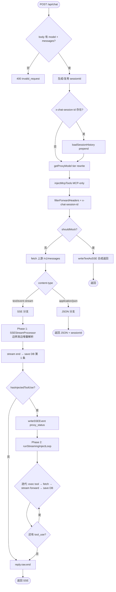

# 02. 端到端请求流转

## 本文档覆盖的源文件

- `apps/proxy-core/src/server/index.ts`
- `apps/proxy-core/src/server/proxy.ts`
- `apps/proxy-core/src/server/chat-route.ts`
- `apps/proxy-core/src/server/middleware/request-id.ts`
- `apps/proxy-core/src/server/data-push.ts`
- `apps/proxy-core/src/utils/request-writer.ts`
- `apps/proxy-core/src/utils/sse-writer.ts`
- `apps/proxy-core/src/utils/tool-injector.ts`
- `apps/proxy-core/src/utils/inject-loop.ts`
- `apps/proxy-core/src/utils/sse-stream-processor.ts`
- `apps/proxy-core/src/utils/machine-id.ts`
- `apps/proxy-cli/src/hooks/useWebSocketData.ts`

本文用一次业务请求串起整个系统，具体到各分支的实现请转到对应深入文档。

## 一次业务请求经过什么

系统有两条业务路径：`/v1/*`（纯代理）和 `/api/chat`（MCP 增强）。下面用 mermaid 展示 `/api/chat` 的完整流程（`/v1/*` 更简单，见 [proxy-forwarding.md](./proxy-core/proxy-forwarding.md)）。



## 关键契约

### 请求 ID

- Fastify `onRequest` 钩子（`middleware/request-id.ts:5-12`）优先取 `x-request-id` 头；缺则 `nanoid(12)`
- 上游返回后从响应头 `x-request-id` 取云端 ID，覆盖 `requestData.requestId`
- 前端用「`sessionId:requestId`」的 `compositeId` 唯一标识一条请求（`request-writer.ts:168`）

### 会话 ID

- `/v1/*`：来自客户端头 `x-claude-code-session-id`，无值时记 `'unknown-session'`
- `/api/chat`：来自客户端头 `x-chat-session-id`，无值时 server 生成 UUID。生成的 sessionId 注入到 `forwardHeaders`（上游始终能看到），并通过 response header `x-chat-session-id` 返回给客户端

### Session Resume

`/api/chat` 独有能力。当客户端带 `x-chat-session-id` 且 DB 中有历史记录：

- `loadSessionHistory(sessionId)` 从 SQLite 加载该 session 的历史 messages + system prompt
- 历史 messages prepend 到当前请求的 messages 前面
- system prompt 仅在当前请求未提供时 carry over

### API Key 双记录

- `apiKey`：客户端原始 Bearer / `x-api-key`
- `proxyApiKey`：实际转发给上游的 key（若 `resolved.apiKey` 存在则用它，否则透传客户端）

两者都写入 `requests` 表，便于审计。

### Model 覆盖（Tier Rewrite）

- `getProxyModel(originalModel, resolved)` 按 tier 映射替换：
  - `claude-haiku*` → `haiku_model`（fallback: `model`）
  - `claude-sonnet*` → `sonnet_model`（fallback: `model`）
  - `claude-opus*` → `opus_model`（fallback: `model`）
  - 其它 → `model`
  - 所有为空 → 不替换
- `/v1/*` 和 `/api/chat` 都使用 `getProxyModel`

### machineId

- `getMachineIdSync()` 返回基于 hostname 的稳定标识（`machine-id.ts`）
- 写入 `requestData.machineId` 和 `requests` 表 `machine_id` 列
- 用于区分多台机器的请求记录

### Header 过滤

`filterForwardHeaders`（`proxy.ts:131-161`）：

- 删掉 `host`（上游会 404）
- 删掉 `content-length`（body 已重新序列化，长度变了）
- 删掉 `x-req-key`
- 若 provider 有 `api_key`，覆盖 `x-api-key` 与 `authorization: Bearer <k>`
- `/api/chat` 还注入 `x-chat-session-id` 到 forwardHeaders

##两条路径的响应分支

### `/v1/*` 三分支（纯代理）

```mermaid
flowchart TD
  START([POST /v1/*]) --> RESOLVE[resolveProxyTarget + getProxyModel]
  RESOLVE --> HEADER[extractSafeHeaders → filterForwardHeaders]
  HEADER --> FETCH[fetch 上游]

  FETCH --> CT{"content-type"}
  CT -- application/json --> JSON[response.text<br/>save + reply.code.send]
  CT -- text/event-stream --> PIPE["reply.hijack + Readable.fromWeb.pipe(reply.raw)<br/>边转发边解析 data: 行"]
  FETCH --> CATCH[catch → error]
  CATCH --> ERR[pushNewRequest(error) → reply.code.send]

  JSON --> END([返回])
  PIPE --> END2[stream end → save + push → 返回]
  ERR --> END3([返回错误])
```

### `/api/chat` 分支（MCP 增强代理）



- `/v1/*` 纯代理：JSON（`proxy.ts:324-362`）、SSE pipe（`proxy.ts:364-426`）、Error（`proxy.ts:428-456`）
- `/api/chat` 增强代理：详见 [chat-api.md](./proxy-core/chat-api.md)

细节请转到 [proxy-core/proxy-forwarding.md](./proxy-core/proxy-forwarding.md)。

## 写库与推送

无论哪条分支，最后都会：

1. 计算 `responseTime = Date.now() - startTime`（SSE 用 `end` 事件时刻）
2. `saveRequestDB(sessionId, cloudRequestId, requestData)`：`INSERT OR REPLACE INTO requests` 完整字段（含 headers/body/events/machine_id/base_url 都 JSON.stringify）
3. `extractTokenUsage`：从 `message_delta` 事件的 `usage` 提取 Token（`request-writer.ts:50-54`）
4. `pushNewRequest`：向 `data-push.ts` 的 `dataClients` 集合广播 JSON

广播消息形状：

```json
{
  "type": "request",
  "action": "new",
  "data": {
    "requestId": "...",
    "sessionId": "...",
    "compositeId": "sess:req",
    "method": "POST",
    "path": "/v1/messages",
    "timestamp": "2026-07-04T...",
    "statusCode": 200,
    "responseTime": 3421,
    "model": "auto",
    "machineId": "hostname-hash",
    "baseUrl": "https://ark.cn-beijing.volces.com",
    "usage": { "input_tokens": ..., "output_tokens": ..., "cache_read_input_tokens": ..., "cache_creation_input_tokens": ... }
  }
}
```

**`/api/chat` 的 DB 记录特点**：一条请求可能产生 1~N 条记录。第 1 条保存原始 SSE events（与客户端收到的完全一致），每次 inject loop 迭代有独立 DB 记录。所有记录共享同一 `sessionId`。

## 面板端消费

`apps/proxy-cli/src/hooks/useWebSocketData.ts:111-165`：

- 收到 `type=request action=new`：去重（同 `compositeId` 剔除旧的） + 追加到列表首 + 按 `timestamp` 倒序 + 截 1000
- 同时 `fetchTodayStats()` 主动刷一次今日汇总（因为 stats 预聚合表每 5 分钟才更新）
- `type=stats action=notify`：触发一次 `fetchStats()` 拉最新 hourly/daily
- `type=status action=snapshot`：直接覆盖 `status` + `history`
- `type=ping`：回一个 `{ type: 'pong' }`，同时刷新 `lastActivity` 时间戳（30s 内无活动即关闭并触发重连）

自动重连：指数退避 1s → 2s → 4s → 8s（封顶）；`connectionState` 转成 `disconnected` 后由 `useEffect` 定时器触发 `connect()`。

## 与并行数据源的关系

| 数据类别 | 主通道 | 备用/初始 REST |
|---|---|---|
| 请求列表 | WebSocket `type=request` | `GET /ui/api/requests?limit=1000` |
| 状态 | WebSocket `type=status`（10s push） | `GET /ui/api/status` + `/ui/api/status/history?duration=3600000` |
| 今日统计 | WebSocket 触发前端主动 GET | `GET /ui/api/stats/today?since=<midnight ISO>` |
| 小时/日聚合 | WebSocket `type=stats` notify 触发主动 GET | `GET /ui/api/stats` |
| 日志 | 独立通道 `/ui/api/logs/stream` | — |
| 配置 | REST only | `GET /ui/api/config` |
| 供应商 | REST only | `GET /ui/api/providers` |
| MCP servers | REST only | `GET /ui/api/mcp/servers` |
| MCP tools | REST only | `GET /ui/api/mcp/tools` |

首帧数据来自 `refreshAll()`（`useWebSocketData.ts:61-75`）并发 5 个 REST；WebSocket 建连后接管增量。

## 性能与容量注意

- SQLite 使用 WAL + `synchronous = NORMAL`（`db.ts:29-30`），单进程写、多连接读友好
- 每次业务请求都会跑 `cleanOldRequestsDB(maxDays)`（`proxy.ts:233`），成本是一个按 timestamp 索引扫描的 DELETE；`maxDays=0` 时函数直接 return
- `stats` 聚合每 5 分钟一次（`proxy.ts:154-160`），并在启动时执行一次
- 大 SSE 响应（工具调用循环）走缓冲路径（`proxy.ts:339`）会占用内存等于响应总大小；纯 pipe 路径不缓冲

## 相关文档

- `/v1/*` 纯代理路径 → [proxy-core/proxy-forwarding.md](./proxy-core/proxy-forwarding.md)
- `/api/chat` 增强代理路径 → [proxy-core/chat-api.md](./proxy-core/chat-api.md)
- Tool 注入 + MCP → [proxy-core/tool-injection.md](./proxy-core/tool-injection.md)
- 供应商 `resolveProxyTarget` → [proxy-core/providers.md](./proxy-core/providers.md)
- UI 端 REST/WebSocket 端点表 → [proxy-core/ui-routes.md](./proxy-core/ui-routes.md)
- 面板消费 → [proxy-cli/data-hooks.md](./proxy-cli/data-hooks.md)
