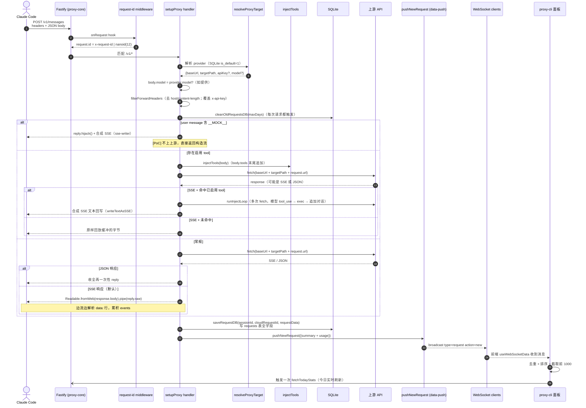

# 02. 端到端请求流转

## 本文档覆盖的源文件

- `apps/proxy-core/src/server/index.ts`
- `apps/proxy-core/src/server/proxy.ts`
- `apps/proxy-core/src/server/middleware/request-id.ts`
- `apps/proxy-core/src/server/data-push.ts`
- `apps/proxy-core/src/utils/request-writer.ts`
- `apps/proxy-core/src/utils/sse-writer.ts`
- `apps/proxy-core/src/utils/tool-injector.ts`
- `apps/proxy-core/src/utils/inject-loop.ts`
- `apps/proxy-cli/src/hooks/useWebSocketData.ts`

本文用一次业务请求串起整个系统，具体到各分支的实现请转到对应深入文档。

## 一次业务请求经过什么



## 关键契约

### 请求 ID

- Fastify `onRequest` 钩子（`middleware/request-id.ts:5-12`）优先取 `x-request-id` 头；缺则 `nanoid(12)`
- 上游返回后从响应头 `x-request-id` 取云端 ID（`proxy.ts:283`），覆盖 `requestData.requestId`
- 前端用「`sessionId:requestId`」的 `compositeId` 唯一标识一条请求（`request-writer.ts:168`）

### 会话 ID

- 来自客户端头 `x-claude-code-session-id`（`proxy.ts:181`）
- 无值时统一记为 `'unknown-session'`

### API Key 双记录

- `apiKey`：客户端原始 Bearer / `x-api-key`
- `proxyApiKey`：实际转发给上游的 key（若 `resolved.apiKey` 存在则用它，否则透传客户端）

两者都写入 `requests` 表，便于审计（`proxy.ts:200-211`）。

### Model 覆盖

- provider 表 `model` 非空时，请求体 `body.model` 会被就地改写（`proxy.ts:186-192`）
- 日志会打印 `model rewrite: <old> -> <new>`

### Header 过滤

`filterForwardHeaders`（`proxy.ts:100-117`）：

- 删掉 `host`（上游会 404）
- 删掉 `content-length`（body 已重新序列化，长度变了）
- 若 provider 有 `api_key`，同时覆盖 `x-api-key` 与 `authorization: Bearer <k>`

## 五条响应分支

`setupProxy` 内部按顺序判断，只走中间的一条：

```mermaid
flowchart TD
  START([请求进入]) --> MOCK{"user message 含 __MOCK__？"}
  MOCK -- 是 --> M[合成 SSE 直接返回<br/>writeTextAsSSE]
  M --> DONE([写库 skip / 立即结束])

  MOCK -- 否 --> INJ{hasEnabledTools() 且 body.tools 非空？}
  INJ -- 是 --> INJTOOL[injectTools 追加到 tools 末尾]
  INJ -- 否 --> FETCH[fetch 上游]
  INJTOOL --> FETCH

  FETCH --> CT{"content-type"}
  CT -- application/json --> JSON[一次读完 response.text<br/>reply.code + send]
  CT -- text/event-stream + 已注入 --> BUF[response.text 缓冲全流]
  BUF --> HIT{parseUpstreamEvents 命中<br/>注入 tool 且 stop_reason=tool_use？}
  HIT -- 否 --> REPLAY[reply.raw.end(fullText)<br/>字节级原样回放]
  HIT -- 是 --> LOOP[runInjectLoop<br/>tool.exec → 追加对话 → fetch]
  LOOP --> SYNTH[writeTextAsSSE 合成结果]

  CT -- text/event-stream + 未注入 --> PIPE["reply.hijack + Readable.fromWeb(response.body).pipe(reply.raw)"]
  PIPE --> STREAM[边转发边解析 data: 行]

  JSON --> SAVE[saveRequestDB]
  REPLAY --> SAVE
  SYNTH --> SAVE
  STREAM --> SAVE
  SAVE --> PUSH[pushNewRequest → WebSocket 广播]
  PUSH --> DONE
```

- MOCK：`proxy.ts:239-254`（`shouldMock` in `sse-writer.ts:50-68`）
- JSON：`proxy.ts:296-333`
- 注入命中/未命中缓冲：`proxy.ts:338-394`
- 常规 SSE pipe：`proxy.ts:396-457`

细节请转到 [proxy-core/proxy-forwarding.md](./proxy-core/proxy-forwarding.md)。

## 写库与推送

无论哪条分支，最后都会：

1. 计算 `responseTime = Date.now() - startTime`（SSE 用 `end` 事件时刻）
2. `saveRequestDB(sessionId, cloudRequestId, requestData)`：`INSERT OR REPLACE INTO requests` 完整字段（含 headers/body/events 都 JSON.stringify）
3. `extractTokenUsage`：从 `message_delta` 事件的 `usage` 提取 Token（`request-writer.ts:50-54`）
4. `pushNewRequest`：向 `data-push.ts` 的 `dataClients` 集合广播 JSON

广播消息形状：

```json
{
  "type": "request",
  "action": "new",
  "data": {
    "requestId": "...",
    "sessionId": "...",
    "compositeId": "sess:req",
    "method": "POST",
    "path": "/v1/messages",
    "timestamp": "2026-07-04T...",
    "statusCode": 200,
    "responseTime": 3421,
    "model": "auto",
    "usage": { "input_tokens": ..., "output_tokens": ..., "cache_read_input_tokens": ..., "cache_creation_input_tokens": ... }
  }
}
```

## 面板端消费

`apps/proxy-cli/src/hooks/useWebSocketData.ts:111-165`：

- 收到 `type=request action=new`：去重（同 `compositeId` 剔除旧的） + 追加到列表首 + 按 `timestamp` 倒序 + 截 1000
- 同时 `fetchTodayStats()` 主动刷一次今日汇总（因为 stats 预聚合表每 5 分钟才更新）
- `type=stats action=notify`：触发一次 `fetchStats()` 拉最新 hourly/daily
- `type=status action=snapshot`：直接覆盖 `status` + `history`
- `type=ping`：回一个 `{ type: 'pong' }`，同时刷新 `lastActivity` 时间戳（30s 内无活动即关闭并触发重连）

自动重连：指数退避 1s → 2s → 4s → 8s（封顶）；`connectionState` 转成 `disconnected` 后由 `useEffect` 定时器触发 `connect()`。

## 与并行数据源的关系

| 数据类别 | 主通道 | 备用/初始 REST |
|---|---|---|
| 请求列表 | WebSocket `type=request` | `GET /ui/api/requests?limit=1000` |
| 状态 | WebSocket `type=status`（10s push） | `GET /ui/api/status` + `/ui/api/status/history?duration=3600000` |
| 今日统计 | WebSocket 触发前端主动 GET | `GET /ui/api/stats/today?since=<midnight ISO>` |
| 小时/日聚合 | WebSocket `type=stats` notify 触发主动 GET | `GET /ui/api/stats` |
| 日志 | 独立通道 `/ui/api/logs/stream` | — |
| 配置 | REST only | `GET /ui/api/config` |
| 供应商 | REST only | `GET /ui/api/providers` |

首帧数据来自 `refreshAll()`（`useWebSocketData.ts:61-75`）并发 5 个 REST；WebSocket 建连后接管增量。

## 性能与容量注意

- SQLite 使用 WAL + `synchronous = NORMAL`（`db.ts:29-30`），单进程写、多连接读友好
- 每次业务请求都会跑 `cleanOldRequestsDB(maxDays)`（`proxy.ts:233`），成本是一个按 timestamp 索引扫描的 DELETE；`maxDays=0` 时函数直接 return
- `stats` 聚合每 5 分钟一次（`proxy.ts:154-160`），并在启动时执行一次
- 大 SSE 响应（工具调用循环）走缓冲路径（`proxy.ts:339`）会占用内存等于响应总大小；纯 pipe 路径不缓冲

## 相关文档

- 五分支代码级说明 → [proxy-core/proxy-forwarding.md](./proxy-core/proxy-forwarding.md)
- Tool 注入循环细节 → [proxy-core/tool-injection.md](./proxy-core/tool-injection.md)
- 供应商 `resolveProxyTarget` → [proxy-core/providers.md](./proxy-core/providers.md)
- UI 端 REST/WebSocket 端点表 → [proxy-core/ui-routes.md](./proxy-core/ui-routes.md)
- 面板消费 → [proxy-cli/data-hooks.md](./proxy-cli/data-hooks.md)
