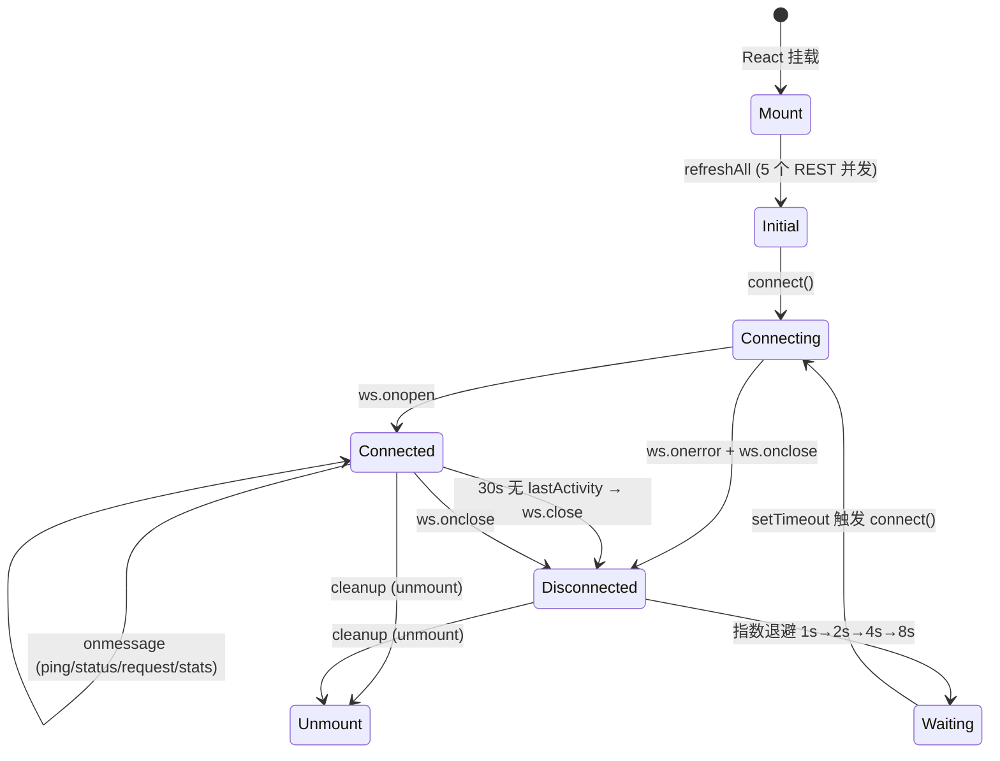

# proxy-cli / 数据 Hooks

## 本文档覆盖的源文件

- `apps/proxy-cli/src/hooks/index.ts`
- `apps/proxy-cli/src/hooks/useConfig.ts`
- `apps/proxy-cli/src/hooks/useLogs.ts`
- `apps/proxy-cli/src/hooks/useWebSocketData.ts`
- `apps/proxy-cli/src/hooks/useInViewControl.ts`

四个 hook 承担面板的全部数据管理。`hooks/index.ts` 是 barrel：

```ts
export { useLogs } from './useLogs'
export { useConfig } from './useConfig'
export { useWebSocketData } from './useWebSocketData'
```

（`useInViewControl` 单独 import。）

## `useConfig` — 冷启动配置一次拉

`apps/proxy-cli/src/hooks/useConfig.ts`：

```ts
export function useConfig(): {
  config: AppConfig | null
  versions: VersionInfo | null
  loading: boolean
  error: string | null
}
```

- `useEffect` 挂载时 `fetchConfig()` 一次
- 成功 → 存 `config / versions`；失败 → 存 error message
- 无自动重试；被 `App.tsx` 用于取 `versions`

## `useWebSocketData` — 主数据通道

`apps/proxy-cli/src/hooks/useWebSocketData.ts`。返回：

```ts
{
  status: StatusApiResponse
  history: StatusDataPoint[]
  requests: RequestSummary[]
  stats: StatsData
  todayStats: TodayStats
  connectionState: 'connecting' | 'connected' | 'disconnected'
  loading: boolean
  reconnect: () => void
}
```

### 生命周期



### 初始并发 REST

`useWebSocketData.ts:61-75`。挂载时 `refreshAll()`：

```ts
const [statusData, historyData, requestsData, statsData, todayData] = await Promise.all([
  fetchStatus(), fetchStatusHistory(), fetchRequests(), fetchStats(), fetchTodayStats()
])
```

设置全部 state + `setLoading(false)`。避免面板首帧空白。

### WebSocket 建立

`useWebSocketData.ts:77-176`：

```ts
const wsHost = import.meta.env.DEV ? 'localhost:3000' : location.host
const wsUrl = `${location.protocol.replace('http', 'ws')}//${wsHost}/ui/api/ws`
const ws = new WebSocket(wsUrl)
```

**dev 硬编码 3000**：与 `useLogs.ts` 一致。生产用 `location.host`（同源 same-origin ws）。

`onopen`：

- `setConnectionState('connected')`
- 重置退避计数 `reconnectAttemptRef.current = 0`
- 启动 heartbeat 检查定时器（每 5s 检查 `now - lastActivity > 30_000`）

### 消息分派 `onmessage`

`useWebSocketData.ts:111-165`：

```ts
switch (msg.type) {
  case 'ping':
    ws.send(JSON.stringify({ type: 'pong' }))
    break

  case 'status':
    if (msg.action === 'snapshot') {
      setStatus({ status, cpu, memory, uptime, restarts })
      setHistory(msg.data.history || [])
    }
    break

  case 'request':
    if (msg.action === 'new') {
      setRequests(prev => {
        const filtered = prev.filter(r => r.compositeId !== msg.data.compositeId)  // 去重
        const withNew = [msg.data, ...filtered]
        const sorted = withNew.sort((a, b) => new Date(b.timestamp).getTime() - new Date(a.timestamp).getTime())
        return sorted.slice(0, 1000)                                                // 截 1000
      })
      fetchTodayStats().then(setTodayStats).catch(() => {})                         // 主动刷今日
    }
    break

  case 'stats':
    if (msg.action === 'notify') fetchStats().then(setStats).catch(() => {})
    break
}
```

- **request 消息处理三步走**：去重 → 排序 → 截尾。虽然后端一般按顺序推送，但 pending 请求过期覆盖等场景可能重复，前端兜底
- **stats notify → 主动 GET**：后端目前**没有**发这条消息（`pushStatsNotify` 未调用），预留
- **ping/pong**：客户端主动回，服务端根据 `lastPing` 判活

### 心跳超时

`useWebSocketData.ts:102-108`：

```ts
heartbeatTimerRef.current = setInterval(() => {
  if (Date.now() - lastActivity > HEARTBEAT_TIMEOUT_MS) {   // 30_000
    setConnectionState('disconnected')
    ws.close()
  }
}, 5000)
```

`lastActivity` 在 `onopen` 和每次 `onmessage` 时更新。任何消息都算活着——即使不是 ping。

### 自动重连（指数退避）

`useWebSocketData.ts:191-204`：

```ts
useEffect(() => {
  if (connectionState !== 'disconnected') return
  if (!mountedRef.current) return                          // 首次挂载不走

  const delay = Math.min(1000 * Math.pow(2, reconnectAttemptRef.current), 8000)
  reconnectAttemptRef.current++

  const timer = setTimeout(() => connect(), delay)
  return () => clearTimeout(timer)
}, [connectionState, connect])
```

`1s → 2s → 4s → 8s → 8s ...`，重连成功后 `reconnectAttemptRef.current = 0` 归位。手动 `reconnect()` 也归位。

### `mountedRef.current` 的作用

避免第一次 render 的 `useEffect` 因 `connectionState: 'connecting'` 变化而误触发重连逻辑。挂载完成后再打开重连闸门。

### 清理

组件卸载时：`wsRef.current?.close()` + 清心跳定时器。

## `useLogs` — 日志 WebSocket

`apps/proxy-cli/src/hooks/useLogs.ts`：

```ts
export function useLogs(options: { level?: string, grep?: string } = {}): {
  logs: LogItem[]
  pause: () => void
  resume: () => void
  clear: () => void
}
```

- 独立于 `/ui/api/ws`，连 `/ui/api/logs/stream`
- 前端只保留 500 条：`setLogs(prev => [...prev.slice(-499), log])`
- `paused` 状态：暂停时忽略新消息（不断连，只不写入 state）
- 客户端二次过滤：`level` 和 `grep`
- `level` 兼容 Pino 数字（10-60）和字符串（`trace/debug/.../fatal`）
- `request_started / request_completed` 类型消息强制打 `level: 'info'`（后端不总带 level 字段）

**当前 App.tsx 没用它**——`useLogs` 是预留 hook，未来加入日志面板组件时启用。dev 时也硬编码 `localhost:3000`。

## `useInViewControl` — 可见性控制

`apps/proxy-cli/src/hooks/useInViewControl.ts`：

```ts
export function useInViewControl(options?: { threshold?, rootMargin? }) {
  const { ref, inView } = useInView({
    threshold: options?.threshold ?? 0,
    rootMargin: options?.rootMargin ?? '200px',
    triggerOnce: false,
    initialInView: true
  })
  return { ref, inView }
}
```

包装 `react-intersection-observer` 的 `useInView`，两个改动：

- **`threshold: 0`**：任何像素可见即 true（默认 0.1 有些边界情况判定慢）
- **`rootMargin: '200px'`**：视口下方 200px 内的元素也算 in-view，提前触发渲染
- **`initialInView: true`**：首次渲染就当在视口内（不然展开的详情会闪一下 loading）
- **`triggerOnce: false`**：滚出去还能变 false（用于卸载非视口的重渲染）

**唯一用途**：`RequestCard` 展开后 tabs 内容懒渲染（`RequestCard.tsx:34`）——避免 20 条请求同时展开时 Shiki 高亮爆内存。

## 相关文档

- 消费的 REST 端点 → [api-layer.md](./api-layer.md)
- 后端 WebSocket 服务器 → [../proxy-core/ui-routes.md](../proxy-core/ui-routes.md)
- 请求卡的懒渲染 → [components-requests.md](./components-requests.md)
