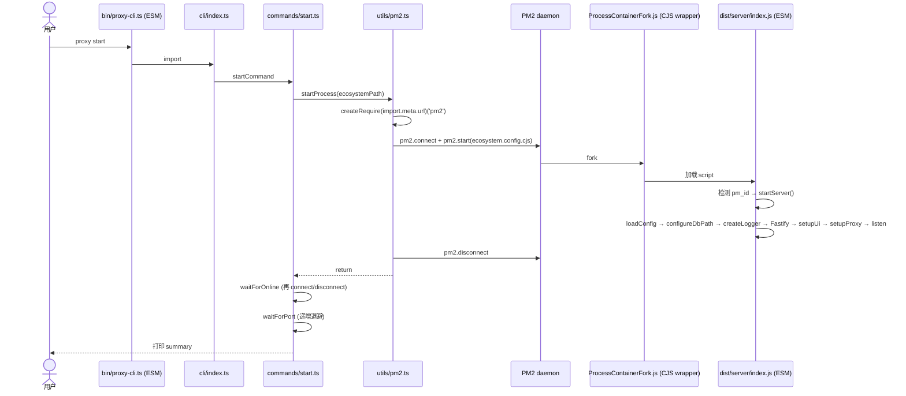

# proxy-core / PM2 集成

## 本文档覆盖的源文件

- `apps/proxy-core/ecosystem.config.cjs`
- `apps/proxy-core/src/utils/pm2.ts`
- `apps/proxy-core/src/utils/esm-dirname.ts`
- `apps/proxy-core/src/server/index.ts:42-60`（入口守卫）

## 挑战

项目根 `package.json` 声明了 `"type": "module"`，因此所有 `.js` 文件默认按 ESM 加载。而 PM2 是 CJS 库，`ecosystem.config.js` 会被解析成 ESM，报 `Cannot use import statement / module.exports is not defined`。同时 PM2 fork 模式启动脚本时会替换 `process.argv[1]`，导致 ESM `import.meta.url === main module url` 判定失败。

三个应对：

1. `ecosystem.config.cjs` 用 `.cjs` 扩展名，绕过 `type: module` 全局设定
2. `utils/pm2.ts` 用 `createRequire(import.meta.url)` 加载 PM2 库
3. `server/index.ts` 用 `pm_id` / `NODE_APP_INSTANCE` 环境变量补检测

## `ecosystem.config.cjs` 逐行

```js
const path = require('path')
const os = require('os')

const dataDir = process.env.CC_DATA_DIR || path.join(os.homedir(), '.cc-monitoring')
const logsDir = path.join(dataDir, 'logs')
const configPath = process.env.CONFIG_PATH || path.join(dataDir, 'config.json')

module.exports = {
  apps: [{
    name: 'cc-monitoring',
    script: path.join(__dirname, 'dist/server/index.js'),
    cwd: dataDir,
    instances: 1,
    exec_mode: 'fork',
    autorestart: true,
    watch: false,
    max_memory_restart: '200M',
    env: {
      NODE_ENV: 'production',
      CONFIG_PATH: configPath
    },
    env_development: {
      NODE_ENV: 'development',
      CONFIG_PATH: configPath
    },
    log_date_format: 'YYYY-MM-DD HH:mm:ss Z',
    error_file: path.join(logsDir, 'error.log'),
    out_file: path.join(logsDir, 'out.log'),
    merge_logs: true
  }]
}
```

关键点：

- `name: 'cc-monitoring'`：CLI 里所有 PM2 操作都用这个进程名（`utils/pm2.ts`、`ui-route.ts` 的 `getProcessStatus('cc-monitoring')` 等）
- `script`：`path.join(__dirname, ...)`——`__dirname` 是 CJS 全局，在 `.cjs` 里可用。相对包内绝对路径，不依赖 `process.cwd()`
- `cwd: dataDir`：让子进程的相对路径日志/DB 落到用户目录
- `instances: 1` + `exec_mode: 'fork'`：cluster 模式基于 worker 复制主进程内存，ESM 会在 worker 里报错；fork 是干净的 spawn Node
- `autorestart: true` + `max_memory_restart: '200M'`：内存超 200M 自动重启（应用层代理有大响应缓冲的可能）
- `watch: false`：不监控文件变动重启（生产模式）
- `env` / `env_development`：`NODE_ENV` 切换；`CONFIG_PATH` 覆盖 `loadConfig` 的读取路径
- `log_date_format`：PM2 自己的日志时间戳（区别于 pino 的 ISO time）
- `error_file / out_file`：PM2 fork 子进程的 stderr/stdout 落盘位置
- `merge_logs: true`：多实例合并（虽然本项目 instances=1，属默认合理设置）

## Node 侧 PM2 封装 `utils/pm2.ts`

```ts
const requireCjs: NodeRequire = (() => {
  try { return createRequire(getCurrentModuleUrl()) } catch { return require }
})()
const pm2 = requireCjs('pm2') as any
```

- `createRequire(getCurrentModuleUrl())`：ESM 环境下让 CJS `require` 可用
- `getCurrentModuleUrl()`（`esm-dirname.ts:52`）包装 `import.meta.url`——`__mocks__/esm-dirname.ts` 里被 Jest 覆盖成静态字符串，因为 ts-jest 编译 CJS 时无法解析 `import.meta`
- 若 `createRequire` 也不可用（比如某种测试环境），fallback 到全局 `require`（此时应用其实已在 CJS 环境）

内部 promisify 六个 PM2 API：

| 内部 | 说明 |
|---|---|
| `pm2Connect()` | 建立与 PM2 daemon 的 IPC |
| `pm2Disconnect()` | 释放（**必须调**否则 daemon 认为客户端仍连着，其它 CLI 会等待） |
| `pm2Start(options)` | options 可以是 ecosystem 路径字符串或对象 |
| `pm2Stop(name)` | |
| `pm2Reload(name)` | 优雅（零停机）重启 |
| `pm2List()` | 返回所有进程数组 |

对外 5 个函数：

- `startProcess(ecosystemPath)` = connect + start + disconnect
- `stopProcess(name)` = 同上
- `reloadProcess(name)` = 同上
- `waitForOnline(name, timeoutMs=8000, intervalMs=300)`：单次 connect + 轮询 list + disconnect（finally 保证释放）
- `getProcessStatus(name)`：单次 connect + list + disconnect，映射到 `Pm2ProcessStatus` 简洁形状

**pm2Start 的错误可能是数组**：PM2 有时候多个 app 同时失败，回调 `err` 是 `Error[]`：

```ts
const error = Array.isArray(err)
  ? new Error(err.map(e => e.message).join('; '))
  : err
```

合成成单个 Error 抛出。

## 双入口守卫 `server/index.ts`

```ts
const _isPm2 = process.env.pm_id !== undefined || process.env.NODE_APP_INSTANCE !== undefined
const _currentModuleUrl = getCurrentModuleUrl()
const _mainModulePath = process.argv[1] ? path.resolve(process.argv[1]) : ''
const _mainModuleUrl = _mainModulePath ? `file://${_mainModulePath}` : ''
const _isDirectExecution = _currentModuleUrl === _mainModuleUrl

if (_isPm2 || _isDirectExecution) {
  startServer().catch(err => { console.error(...); process.exit(1) })
}
```

- **PM2 fork 特殊性**：PM2 用 `child_process.fork(ProcessContainerFork.js)` 拉起进程，`process.argv[1]` 是 `ProcessContainerFork.js` 而非 `dist/server/index.js`。所以 `_isDirectExecution` 判定为 false。用 `pm_id` env 补检测
- **直接执行**：`tsx src/server/index.ts` 或 `node dist/server/index.js`，`argv[1]` 就是本文件，URL 相等
- **测试 / import**：既不是 PM2 也不是直接执行时（例如从测试文件 import），两个判定都是 false，`startServer` 不自动跑，测试可以控制生命周期

**注释里说明**：`server/index.ts:42-45` 明确指出为什么不能用 `require.main === module`——那是 CJS 模式的判定，ESM 里 `require` 不存在。

## ESM __dirname 替代 `esm-dirname.ts`

```ts
const thisDirname: string = (() => {
  try { return path.dirname(new URL(import.meta.url).pathname) }
  catch { return typeof __dirname !== 'undefined' ? __dirname : process.cwd() }
})()

export function getCallerDirname(relativePath: string): string {
  return path.resolve(thisDirname, relativePath)
}

export function getCurrentModuleUrl(): string {
  return import.meta.url
}
```

- `thisDirname`：本模块自身的 __dirname 等价物（编译后位于 `dist/utils/`）
- `getCallerDirname('../server')`：调用方直接算出 `dist/server` 目录，不用自己 fiddle import.meta.url。多处使用（`ui-route.ts:396` 静态资源、`start.ts:32` ecosystem 路径、`ui.ts:9` UI dist 路径、`utils/version.ts:14` 版本文件）
- 三重 fallback（ESM → CJS `__dirname` → `process.cwd()`）覆盖所有环境

**注释里明确**：`getCurrentModuleUrl` 是包装函数而非直接内联 `import.meta.url`——因为 ts-jest 编译 CJS 时会遇到语法错误，`__mocks__/esm-dirname.ts` 可以在测试里替换整个模块返回固定值。

## 冷启动全流程



## 相关文档

- CLI 命令细节 → [cli-commands.md](./cli-commands.md)
- 启动链 → [entry-and-bootstrap.md](./entry-and-bootstrap.md)
