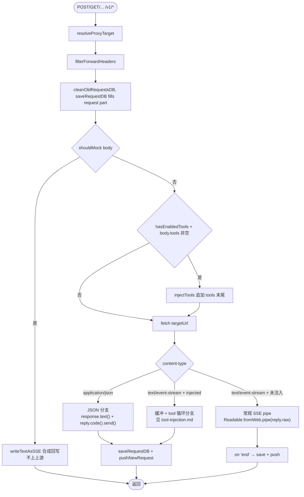

# proxy-core / 代理转发

## 本文档覆盖的源文件

- `apps/proxy-core/src/server/proxy.ts:1-487`
- `apps/proxy-core/src/utils/sse-writer.ts`

## 顶层结构

`setupProxy(fastify, proxyConfig)`（`proxy.ts:142-486`）注册一个 `fastify.all('/v1/*', ...)`。函数在服务启动时执行一次，主要做四件事：

1. `initDatabase()`
2. 启动 `aggregateStats` 定时器（5 分钟一次；启动时立即跑一次）
3. `fastify.addHook('onClose', ...)`：关服时 `clearInterval` + `closeDatabase()`
4. 注册请求 handler

请求 handler 是本文的核心。

## 为什么不用 `@fastify/http-proxy`

Fastify 生态里有透明代理插件，但项目最早使用后遇到了矛盾：透明代理内部完全接管 request stream，任何试图读 body 的操作都会消耗 stream。而本项目要同时满足：

- 记录完整 payload（model / messages / tools / MCP 参数）
- 原样转发 SSE 流
- 未来扩展 Token 统计、鉴权、审计

HTTP stream 只能被消费一次，于是切到「应用层转发」：Fastify 让 body 先被解析成 JSON，业务代码用 `fetch()` 主动发起上游请求，响应体用 `Readable.fromWeb().pipe(reply.raw)` 转发。

## Handler 五分支



分支的公用部分见下面 [公用步骤](#公用步骤)，五个分支分别见后续小节。

## 公用步骤

### `resolveProxyTarget(proxyConfig)`

`proxy.ts:40-84`。每次请求同步查一次 `providers WHERE is_default = 1 LIMIT 1`。better-sqlite3 是同步 API，单行 SELECT 微秒级，无需缓存。

策略：

- 起始值 = 从 `config.proxy.target` 解析出 `baseUrl` + `targetPath`，`apiKey = config.proxy.apiKey`
- 若激活的 provider 有 `base_url` 且非空 → 覆盖 baseUrl/targetPath
- 若 `api_key` 非空 → 覆盖 apiKey
- 若 `model` 非空 → 记入返回值（供后续替换请求体 model）
- 任何异常（DB 未初始化 / URL 解析失败）→ fallback 只用 config

返回 `{ baseUrl, targetPath, apiKey?, model? }`。

### 请求元数据组装

`proxy.ts:181-232`：

- `sessionId = headers['x-claude-code-session-id'] || 'unknown-session'`
- 原始 model 备份到 `originalModel`；provider 有 model 时替换 `request.body.model`（原地修改，因为 handler 后面还要 `JSON.stringify(request.body)` 转发）
- `filterForwardHeaders(headers, resolved.apiKey)`：删 host/content-length；有 provider key 则覆盖 `x-api-key` 和 `authorization`
- 从 Authorization / x-api-key 头提取客户端原 apiKey；从 filtered 后的 headers 提取实际发给上游的 proxyApiKey
- 组装 `RequestData`：request 部分立即填齐，response 部分先占位（`statusCode: 0, events: []`）

### 记录与清理

- `cleanOldRequestsDB(maxDays)`：每次请求都跑一次 DELETE（`maxDays=0` 时函数直接 return）
- `request.log.info(...)` 打印请求摘要

## 分支 1：MOCK

`proxy.ts:239-254`：

```ts
if (shouldMock(request.body)) {
  reply.hijack()
  reply.raw.writeHead(200, { 'content-type': 'text/event-stream', ... })
  writeTextAsSSE(reply.raw, '[PoC] 这是 proxy 构造的合成响应，未经过真实大模型。', `msg_poc_${request.id}`)
  reply.raw.end()
  return
}
```

- `shouldMock(body)`（`sse-writer.ts:50-68`）：向后扫描 `messages` 找最后一条 `role === 'user'`，若 content 是字符串或 block 数组中的 text 块含 `__MOCK__` → true
- `reply.hijack()`：告诉 Fastify 不接管响应，用户自己控制 `reply.raw`（Node HTTP 原生 socket）
- `writeTextAsSSE`：按 Anthropic 事件骨架输出 `message_start` → `content_block_start` → `content_block_delta` → `content_block_stop` → `message_delta` → `message_stop`（详见 [tool-injection.md](./tool-injection.md#合成-sse-writer)）
- **注意**：MOCK 分支既不 fetch 上游，也不写数据库、不 push；仅日志一行

## 分支 2：JSON 响应

`proxy.ts:296-333`。当上游返回 `content-type: application/json`（通常是错误响应或非流式）：

- `const responseBody = await response.text()`
- 尝试 `JSON.parse(responseBody)`；成功则把整个 body 作为单一 event `push` 到 `events` 数组；失败则 push `{ raw: responseBody }`
- 更新 `requestData.response.statusCode / headers / completedAt`
- `saveRequestDB` 写库
- `extractTokenUsage` 提取 usage（从 events 中找 `type === 'message_delta'`）
- `pushNewRequest` 广播
- `reply.code(response.status).headers(...).send(responseBody)` 原样返回给客户端

优点：完整错误信息进库，方便调试云端 429/401/500。

## 分支 3：SSE + Tool 注入

`proxy.ts:338-394`。**只有 tool 被注入且响应是 SSE 时才走**。为什么要缓冲：无法边流边判断模型是否命中了注入的 tool（要看到 `stop_reason: tool_use` 才能确定）。

- `const fullText = await response.text()`：一次性收全流
- `parseSSEText(fullText)`：切行 → `data:` 行 → `JSON.parse`，存到 events 数组
- `parseUpstreamEvents(events)`：重建有序 content blocks + stop_reason + usage
- `findInjectedCall(parsed)`：找命中的 tool_use 块（其 `name` 在 registry 的 `enabledTools` 中）

**未命中**（`hitInjected === false`）：

- `reply.raw.writeHead(response.status, response.headers)`
- `reply.raw.end(fullText)`：字节级原样回放缓冲的整个上游响应，客户端无感知

**命中**：进入 `runInjectLoop`（详见 [tool-injection.md](./tool-injection.md)）：

```ts
const loop = await runInjectLoop({
  events,
  body: request.body,
  callUpstream: async (b) => {
    const r = await fetch(targetUrlStr, { method: request.method, headers: forwardHeaders, body: JSON.stringify(b) })
    return parseSSEText(await r.text())
  }
})
reply.raw.writeHead(200, { 'content-type': 'text/event-stream', ... })
writeTextAsSSE(reply.raw, loop.text, `msg_inject_${cloudRequestId}`)
```

写库/推送在最后共同分支执行（`proxy.ts:377-393`）。

## 分支 4：SSE + 未注入（默认路径）

`proxy.ts:396-457`。零缓冲：

```ts
reply.hijack()
reply.raw.writeHead(response.status, responseHeaders)
const nodeStream = Readable.fromWeb(response.body as any)

nodeStream.on('data', (chunk) => {
  // 边转发边解析 data: 行到 requestData.response.events
})
nodeStream.on('end', async () => {
  requestData.response.completedAt = new Date().toISOString()
  await saveRequestDB(...)
  pushNewRequest(...)
})
nodeStream.pipe(reply.raw)
```

- **Web ReadableStream → Node Readable**：`Readable.fromWeb()`（Node 18+ 提供）
- **数据事件双职责**：pipe 会把 chunk 转发出去，同时 handler 里手动解析 `data:` 前缀行提取 event（含 Anthropic 双行 `event:xxx\ndata:{...}` 格式）
- **保留原响应头**：不覆盖 content-type，客户端拿到的响应长得跟直连上游一样

### SSE 解析容错

`proxy.ts:412-427`：

```ts
const lines = text.split('\n')
for (const line of lines) {
  if (line.startsWith('data:')) {
    const eventData = line.slice(5).trim()
    if (eventData && eventData !== '[DONE]') {
      try { requestData.response.events.push(JSON.parse(eventData)) } catch {}
    }
  }
}
```

同时兼容标准 `data: {...}` 和阿里云的 `event:xxx\ndata:{...}` 双行格式（`event:` 行被忽略）。`[DONE]` 也跳过。

### chunk 边界问题

**已知边界**：如果一个 `data: {...}` 事件跨 chunk 被截断，当前实现会解析失败（`JSON.parse` 抛错被 catch 吞掉）。数据库里丢一条 event 但不影响客户端流转发。项目里另有 `SSEAccumulator`（`utils/sse-accumulator.ts`）是完整的 Transform 流，但在 `proxy.ts` 当前路径中**未启用**。

## 分支 5：错误分支

`proxy.ts:459-485`：

- 上游 `fetch` 抛错时命中
- `getErrorStatusCode`：`ECONNREFUSED` / `ENOTFOUND` → 502；`ETIMEDOUT` → 504；其它 → 500
- `getErrorMessage`：三选一或 `Proxy error`
- 仍然 `pushNewRequest` 一条含错误 statusCode 的记录（供面板显示红色徽章）
- 响应体：`{ error, requestId }` JSON

## 关键决策

- **`reply.hijack()` 的语义**：Fastify 停止管你，包括路由响应、日志钩子、`onSend` hook。之后你必须自己 `reply.raw.end()`，否则连接挂着
- **重新序列化 body**：`fetch` 的 body 用 `JSON.stringify(request.body)`。这意味着如果客户端发送的 JSON 有非语义变化（空格、字段顺序），代理会「格式化」它。对语义无影响，但会影响某些希望做 body hash 的场景
- **URL 拼接**：`targetUrlStr = baseUrl + targetPath + request.url`。例如 `baseUrl='https://ark.cn-beijing.volces.com'` + `targetPath='/api/coding'` + `request.url='/v1/messages'` = `https://ark.cn-beijing.volces.com/api/coding/v1/messages`。因此 provider 的 base_url 应写成含 API 前缀的形式
- **一次请求两次 `Date.now()`**：`startTime` 在 handler 入口；SSE 分支的 `elapsed` 在 `end` 事件；同步分支（JSON/MOCK）在 `send` 前。都体现 handler 视角的耗时
