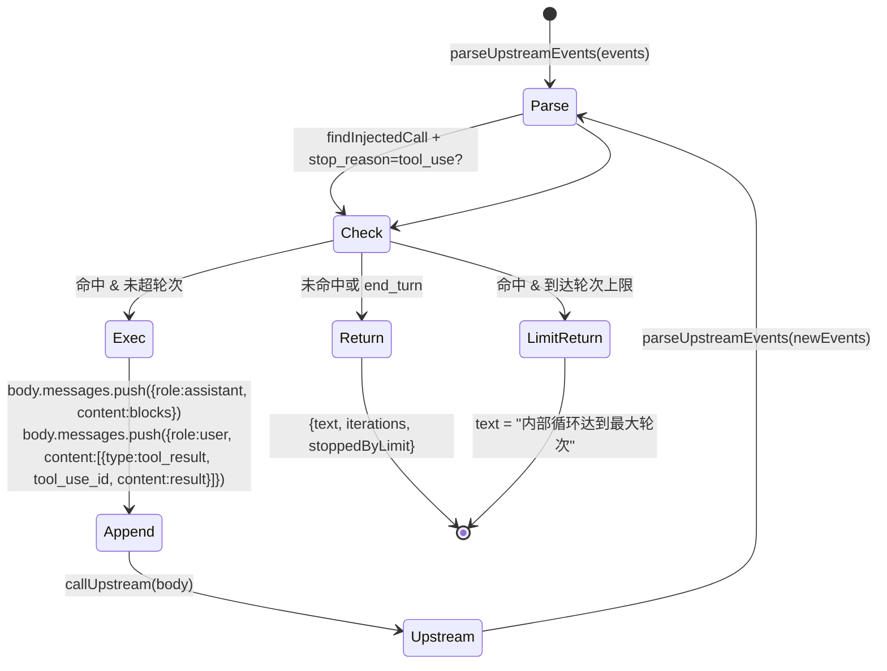

# proxy-core / Tool 注入

## 本文档覆盖的源文件

- `apps/proxy-core/src/tools/index.ts`
- `apps/proxy-core/src/tools/types.ts`
- `apps/proxy-core/src/tools/registry.ts`
- `apps/proxy-core/src/tools/curl.tool.ts`
- `apps/proxy-core/src/tools/probe.tool.ts`
- `apps/proxy-core/src/utils/tool-injector.ts`
- `apps/proxy-core/src/utils/inject-loop.ts`
- `apps/proxy-core/src/utils/sse-writer.ts`
- `apps/proxy-core/src/server/proxy.ts:260-394`

## 概念

「Tool 注入」= 在 proxy 转发前把一些**自定义 tool** 追加到请求体的 `tools` 数组末尾。上游模型可能调用这些 tool；proxy 检测到命中后**在后端本地执行 exec**，把结果作为 `tool_result` 追加到对话，然后再次调用上游，直到模型给出最终文本，最后合成 SSE 回写给客户端。

对客户端（Claude Code）而言，这次调用看起来像一次普通的文本响应；实际上 proxy 已经代替客户端完成了若干轮工具调用。

设计目标见 `docs/thinks/tool-plugin-injection-plan.md`（用户历史设计文档）。

## 三层结构

```
tools/registry.ts    →   注册表 ALL_TOOLS
tools/*.tool.ts      →   单个 tool 定义（name + description + input_schema + enabled + exec）
utils/tool-injector  →   在请求发送前追加到 body.tools
utils/inject-loop    →   命中后的内部循环
utils/sse-writer     →   合成 SSE 回写
```

## `InjectableTool` 接口

`tools/types.ts:16-30`：

```ts
export interface InjectableTool {
  name: string                          // 唯一，注入 + 命中检测 + tool_result 配对
  description: string                   // 给模型看（决定何时调用）
  input_schema: ToolInputSchema         // JSON Schema，type=object
  enabled: boolean                      // 是否启用
  exec(input: any): string | Promise<string>  // 本地执行，返回字符串给上游
}
```

三件套 `name / description / input_schema` 会随 `injectTools` 写进请求体的 `tools` 数组；`enabled` 和 `exec` 是本地元数据，**不进入请求体**。

## 已内置的 2 个 tool

### `probeTool`（`tools/probe.tool.ts`）

```ts
{
  name: '__inject_probe',
  description: '当 user 消息含 __PROBE__ 时必须调用此 tool 回显请求',
  input_schema: { echo: string, required: ['echo'] },
  enabled: false,   // 默认关
  exec(input) { return 'Probe executed. Received echo: "<...>". Now answer directly; do NOT call __inject_probe again.' }
}
```

PoC 验证工具。把 `enabled` 改成 `true` 后端到端跑一遍：

- Claude Code 发含 `__PROBE__` 的 user message
- proxy 把 `__inject_probe` 追加到 tools
- 上游模型看到描述后决定调用它
- proxy 捕获 tool_use → 本地跑 exec → 生成 tool_result → 再调上游
- 上游模型此时应给出正式文本回答（描述里明确要求「不要再次调用」）
- proxy 合成 SSE 把文本回给客户端

### `curlTool`（`tools/curl.tool.ts`）

```ts
{
  name: 'curl_proxy',
  description: 'Use this tool to fetch data from a local service or API...',
  input_schema: { url: string, method?: 'GET'|'POST', body?: string, required: ['url'] },
  enabled: true,   // 默认开
  async exec(input) {
    const response = await fetch(url, { method, headers: { 'Content-Type': 'application/json' }, body })
    const data = await response.text()
    return `Successfully fetched from ${url}:\n\n${data.substring(0, 2000)}`
  }
}
```

给模型一个能拉本地服务的能力（本机 API 探测、开发调试）。响应文本截断到 2000 字符，避免灌爆上下文。

## 注册表 `registry.ts`

```ts
const ALL_TOOLS: InjectableTool[] = [probeTool, curlTool]

export function enabledTools(): InjectableTool[]  { return ALL_TOOLS.filter(t => t.enabled) }
export function hasEnabledTools(): boolean        { return ALL_TOOLS.some(t => t.enabled) }
export function findEnabledTool(name): InjectableTool | undefined
```

新增 tool：`tools/xxx.tool.ts` 导出 `InjectableTool` → 在 `ALL_TOOLS` 添一行 → 决定 `enabled` 初值。

`tools/index.ts` 是 barrel：`export { enabledTools, hasEnabledTools, findEnabledTool } from './registry.js'` + `export type { InjectableTool, ToolInputSchema } from './types.js'`。

## `injectTools(body)`

`utils/tool-injector.ts:17-32`：

```ts
if (!Array.isArray(body?.tools) || body.tools.length === 0) return []

const injected: string[] = []
for (const tool of enabledTools()) {
  if (body.tools.some(t => t?.name === tool.name)) continue   // 幂等
  body.tools.push({ name: tool.name, description: tool.description, input_schema: tool.input_schema })
  injected.push(tool.name)
}
return injected
```

### 关键约束

- **仅对主对话生效**：`body.tools` 非空数组才注入。辅助请求（子任务、抽取式请求）通常无 tools 字段，不动它避免破坏原有 model 约束
- **追加到末尾**：Anthropic 按 `tools → system → messages` 顺序算前缀哈希，往中间或前面插会连带击穿 system prompt cache。追加末尾只让 tools 段末端缓存失效
- **幂等**：已存在同名 tool 就跳过
- **仅写三件套**：exec/enabled 是本地状态，模型不需要知道

## `hasEnabledTools()` 是分支门槛

`proxy.ts:263-269`：

```ts
let injectedNames: string[] = []
if (hasEnabledTools()) {
  injectedNames = injectTools(request.body)
  ...
}
const injected = injectedNames.length > 0
```

若 registry 中所有 tool 的 `enabled: false`（例如 probe 默认关、curl 也关掉），`hasEnabledTools()` 直接 return false，`injected` 永远是 false，转发路径完全等同于「常规 SSE pipe」——**零性能影响**。这是「零影响」的关键设计：不启用 tool 时代码路径与旧版一致。

## 内部循环 `runInjectLoop`

只在**响应是 SSE 且检测到注入 tool 命中**时启用。`utils/inject-loop.ts:127-157`：

```ts
export async function runInjectLoop(opts: {
  events: any[]
  body: any
  callUpstream: (body) => Promise<any[]>
  maxIterations?: number    // 默认 3
}): Promise<InjectLoopResult>
```

流程：



### 每步解析

1. `parseUpstreamEvents(events)`（`inject-loop.ts:43-87`）：从 SSE 事件流重建 `blocks[]` + `stopReason` + `usage`
   - `content_block_start` → 建 block（记 type/id/name/init text 或 input）
   - `content_block_delta` → 累加：`text_delta` 到 `text`；`thinking_delta` 到 `text`（同一容器，简化）；`input_json_delta` 到 `input` 字符串
   - `message_delta` → 更新 `stopReason` 和 `usage`
2. 最后把 `tool_use` block 的 `input` 字符串 JSON.parse 成对象（失败降级 `{}`）
3. `findInjectedCall(parsed)`：找 `type === 'tool_use'` 且 `findEnabledTool(name)` 存在的 block
4. 若无命中 or `stopReason !== 'tool_use'` → 结束，返回累积文本
5. 命中且未超轮次：
   - `tool.exec(call.input)` 得到 result 字符串
   - `body.messages.push({role:'assistant', content: blocksToAssistantContent(blocks)})`
   - `body.messages.push({role:'user', content: [{type:'tool_result', tool_use_id: call.id, content: result}]})`
   - `callUpstream(body)` 再调一次上游
   - 迭代
6. 超轮次 → 返回 `text || '(内部循环达到最大轮次)'`, `stoppedByLimit: true`

### `blocksToAssistantContent`

`inject-loop.ts:97-104`。只把 `text` 和 `tool_use` 块转成 API 格式，**跳过 thinking 块**——thinking 有 signature 校验（Anthropic 的 extended thinking API），把它塞回请求会引发不一致。用户可读文本被合并到 `text` 块。

### `maxIterations = 3`

护栏：tool 描述可能诱导模型反复调用同一 tool（例如 curl 说不清楚参数时）。3 轮后强制退出。

## 缓冲检测（在 `proxy.ts` 内）

`proxy.ts:338-394`：

```ts
if (injected && isSSE && response.body) {
  const fullText = await response.text()
  const events = parseSSEText(fullText)
  requestData.response!.events = events

  const parsed = parseUpstreamEvents(events)
  const hitInjected = findInjectedCall(parsed) && parsed.stopReason === 'tool_use'

  reply.hijack()

  if (!hitInjected) {
    reply.raw.writeHead(response.status, Object.fromEntries(response.headers))
    reply.raw.end(fullText)     // 字节级原样回放
  } else {
    const loop = await runInjectLoop({ events, body: request.body, callUpstream })
    reply.raw.writeHead(200, { 'content-type': 'text/event-stream', ... })
    writeTextAsSSE(reply.raw, loop.text, `msg_inject_${cloudRequestId}`)
    reply.raw.end()
  }
  ...
}
```

- 缓冲成本：一次响应完整占内存（对大响应有压力）
- 未命中：字节级回放，客户端无感知
- 命中：合成 SSE 只发一次文本，中间的 tool 调用序列不透传给客户端

## 合成 SSE `sse-writer.ts`

`writeSSEEvent(raw, event)` 按 Anthropic 双行格式写：`event: <type>\ndata: <json>\n\n`。

`writeTextAsSSE(raw, text, messageId)` 生成一次完整的合法事件流：

```
message_start                       (usage 全 0，model 'auto')
content_block_start (text 块 0)
content_block_delta (text_delta → 一次性把全部文本吐出)
content_block_stop
message_delta (stop_reason: end_turn)
message_stop
```

`messageId` 由 proxy 自己生成（如 `msg_inject_<cloudRequestId>` / `msg_poc_<requestId>`）：合成流没有上游 id，全程用一致的假 id。

`shouldMock(body)`：`__MOCK__` PoC 触发词（详见 [proxy-forwarding.md](./proxy-forwarding.md#分支-1mock)）。

## 与前端的关系

前端**不知道**这次响应经历了几轮 tool 调用。请求历史面板里看到的是：

- 请求 body 含原始 messages + 前端未见过的 tools 追加（`request_body` 字段保存的是原始 body，注入的 tools 也被写入——因为 `saveRequestDB` 保存的是修改后的对象）
- `response_events` 是**首次**上游响应的 events；后续 tool 循环调用不再保存
- `usage` 也只反映首次响应

这是当前实现的取舍：数据库里保存的是完整的第一次上游对话；tool 循环的内部消耗对客户端不可见，也对面板不可见。

## 相关文档

- `proxy.ts` 五分支中的 tool 注入分支 → [proxy-forwarding.md](./proxy-forwarding.md#分支-3sse--tool-注入)
- MOCK 分支使用同一 `sse-writer.ts` → [proxy-forwarding.md](./proxy-forwarding.md#分支-1mock)
