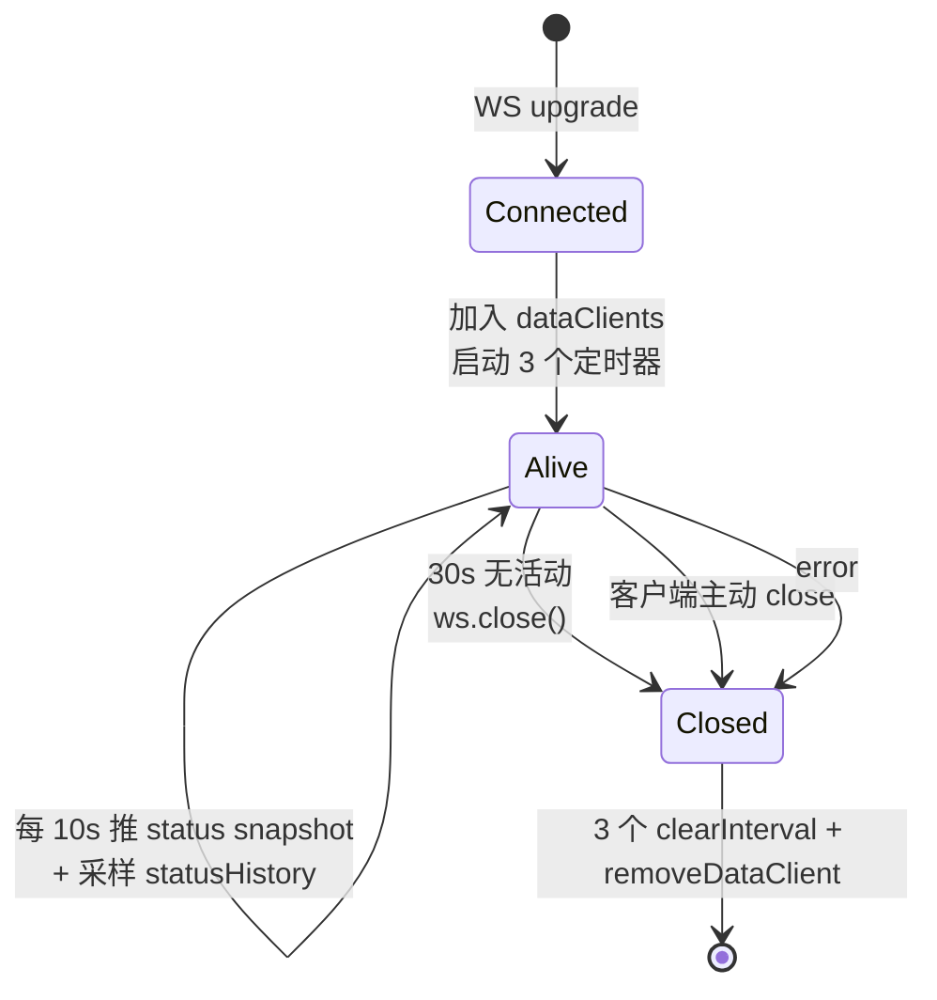

# proxy-core / UI Routes

## 本文档覆盖的源文件

- `apps/proxy-core/src/server/ui-route.ts`
- `apps/proxy-core/src/server/data-push.ts`
- `apps/proxy-core/src/server/auth.ts`
- `apps/proxy-core/src/utils/status-history.ts`

`setupUiRoutes(fastify)`（`ui-route.ts:18`）在 `setupProxy` 之前注册，避免 `/ui/*` 被通配的 `/v1/*` 吞掉。它挂载：

- REST 端点 9 条 + 供应商 API（`providers-route.ts`）+ MCP 管理 API（`mcp-route.ts`）
- Exec API（`ui-route.ts` 内联）
- 两个 WebSocket 通道（`/ui/api/logs/stream`、`/ui/api/ws`）
- 静态资源（`/ui/`）

## REST 端点

| 方法 | 路径 | 认证 | 功能 |
|---|---|---|---|
| GET | `/ui/api/status` | 否 | PM2 进程状态（cpu/memory/uptime/restarts） |
| GET | `/ui/api/status/history?duration=<ms>` | 否 | CPU/内存滑动窗口（默认 1h） |
| GET | `/ui/api/config` | 否 | 当前配置 + 版本信息 + 配置文件路径 |
| POST | `/ui/api/config` | **是** | Zod 校验 + 保存 + 可选延迟 reload |
| GET | `/ui/api/requests?limit=1000` | 否 | 请求摘要列表 |
| GET | `/ui/api/requests/:id` | 否 | 单条请求详情（含 events） |
| GET | `/ui/api/stats` | 否 | 预聚合 hourly（24 条） + daily（30 条） |
| GET | `/ui/api/stats/today?since=<ISO>` | 否 | 今日实时统计（按客户端零点） |
| POST | `/ui/api/control` | **是** | start/stop/restart 进程 |
| GET | `/ui/api/providers` | 否 | 供应商列表 |
| POST | `/ui/api/providers` | **是** | 批量保存（destructive replace） |
| GET | `/ui/api/mcp/servers` | 否 | MCP server 列表（含连接状态） |
| POST | `/ui/api/mcp/servers` | **是** | 创建 MCP server |
| PATCH | `/ui/api/mcp/servers/:id` | **是** | 更新 MCP server（触发 reconnect） |
| DELETE | `/ui/api/mcp/servers/:id` | **是** | 删除 MCP server（先 disconnect） |
| GET | `/ui/api/mcp/tools` | 否 | 已发现的 MCP tool 列表 |
| POST | `/ui/api/mcp/servers/:id/reconnect` | **是** | 手动 reconnect MCP server |
| GET | `/ui` | 否 | 返回 index.html |
| GET | `/ui/**` | 否 | 静态资源（wildcard） |

「认证」列指是否走 `checkAuth`（见 [auth](#auth-token)）。

### GET /ui/api/status

`ui-route.ts:44-54`。返回：

```json
{ "status": "online", "cpu": 0.3, "memory": 45678912, "uptime": 1720029000000, "restarts": 0 }
```

`status` 未查到进程时为 `'stopped'`。`uptime` 是 PM2 内部的 `pm_uptime`（进程启动的 Unix 毫秒）。

### GET /ui/api/status/history

`ui-route.ts:56-59`。`duration` 是回看时间窗（毫秒，默认 3600000）。数据来自内存中的 `statusHistory` 单例（下节），**不持久化**——重启进程后清零。

### GET /ui/api/config

`ui-route.ts:61-65`。合成 `{ config, versions, configPath }`：

- `config`：Zod 校验后的完整对象
- `versions`：`{ projectVersion, claudeVersion }`（`utils/version.ts`）
- `configPath`：`getConfigPath()` 返回值，供 UI 显示当前用哪份 config

### POST /ui/api/config

`ui-route.ts:67-112`。请求体：`{ ...configFields, reload?: boolean }`。

1. `checkAuth`：Bearer Token 校验，失败 401
2. 抽出 `reload` 字段，剩余对象走 `validateConfig`（动态 import schema）
3. 校验失败 → 400 + `{ success: false, errors: [{field, message}] }`
4. `saveConfig(result.data)` 写回文件
5. 若 `reload === true` 且当前 PM2 状态 online：`setTimeout(..., 5000)` 延迟 5s 后 `reloadProcess`（先返回响应，让客户端不因重启而丢连接）
6. 返回 `{ success: true, reloaded, restartingIn?: 5000 }`

### GET /ui/api/requests

`ui-route.ts:129-141`。`limit` 默认 1000。返回 `{ requests: RequestSummary[] }`（`utils/request-writer.ts:152-185`）。摘要字段：`requestId / sessionId / compositeId / timestamp / method / path / statusCode / responseTime / apiKey / proxyApiKey / baseUrl / model / usage`。

### GET /ui/api/requests/:id

`ui-route.ts:115-126`。`id` 是 `compositeId`（`sessionId:requestId`）。调用 `loadRequestDB` 反解表行到 `RequestData`（含 headers/body/events）。找不到 → 404。

### GET /ui/api/stats

`ui-route.ts:144-154`。从 `stats` 表读预聚合数据（详见 [stats-and-history.md](./stats-and-history.md)）。

### GET /ui/api/stats/today

`ui-route.ts:158-175`。查询串 `since` 是 ISO 时间戳（客户端本地零点）；缺失或非法则用服务器本地零点。返回 `TodayStats`（tokens 汇总 + 请求数 + 按 model 计数）。

### POST /ui/api/control

`ui-route.ts:178-217`。请求体 `{ action: 'start' | 'stop' | 'restart' }`。

- `start`：`getCallerDirname('../server') + '../../ecosystem.config.cjs'` 拼出 ecosystem 路径，`startProcess()`
- `stop`：`stopProcess('cc-monitoring')`
- `restart`：`setTimeout(1000, reloadProcess)` 延迟 1s 重启，同步返回 `{ success: true, restartingIn: 1000 }`
- 其它 → 400

`restart` 延迟的目的与 config POST 相同：让本次响应先落地，再让 PM2 接手。

### MCP Server 管理 API

`mcp-route.ts` 提供 6 个端点管理 MCP server 配置与连接。

**GET /ui/api/mcp/servers**：列出所有 MCP server + 实时连接状态。`listMcpServers(db)` 返回 DB 行，`mcpManager.getConnectionsInfo()` 提供 status + toolCount，两表 join。

**POST /ui/api/mcp/servers**：创建新 server。认证 required。`createMcpServer(db, input)` 写 DB + `mcpManager.addServer(created)` 连接。

**PATCH /ui/api/mcp/servers/:id**：更新 server。认证 required。`updateMcpServer(db, id, partial)` 合并更新 + `mcpManager.reconnectServer(id)` 重建连接。

**DELETE /ui/api/mcp/servers/:id**：删除 server。认证 required。先 `mcpManager.removeServer(id)` 断连接，再 `deleteMcpServer(db, id)` 清 DB。

**GET /ui/api/mcp/tools**：列出所有已发现 MCP tool（从 `mcpManager.getMcpTools()` 读缓存）。返回 `{ tools }`（name + description + input_schema）。

**POST /ui/api/mcp/servers/:id/reconnect**：手动 reconnect。认证 required。`mcpManager.reconnectServer(id)`。

### Exec API

`ui-route.ts` 内联注册 `POST /ui/api/exec`。认证 required。让 Claude Code 通过 proxy 执行本地命令。

请求体：`{ tool: 'claude', prompt: string, stream?: boolean, sessionId?: string, allowedTools?: string[] }`。

响应：stream=true 时 SSE 流式输出 Claude Code 执行结果；stream=false 时 JSON。

## checkAuth

`server/auth.ts`：

```ts
export function checkAuth(request, config): boolean {
  const token = config?.auth?.token || process.env.UI_AUTH_TOKEN
  if (!token) return true   // 未配置 → 放行（开发模式）
  const authHeader = request.headers?.authorization
  if (!authHeader) return false
  const provided = authHeader.startsWith('Bearer ')
    ? authHeader.slice(7)
    : authHeader
  return provided === token
}
```

三种情况：

- 未配置任何 token：完全无认证（本地开发默认状态）
- config.auth.token 存在 → 用它
- 否则 fallback 到环境变量 `UI_AUTH_TOKEN`（PM2 生产部署常用）

## 两个 WebSocket 通道

`ui-route.ts:25-42`：不用 `@fastify/websocket`（有多个既知问题），而是自建两个 `WebSocketServer({ noServer: true })`，挂到 `fastify.server.on('upgrade', ...)`：

- `/ui/api/logs/stream` → `handleLogStream`
- `/ui/api/ws` → `handleDataStream`

### handleLogStream（`ui-route.ts:226-316`）

流程：

1. 检查 `config.logging.file` 可读；不可读时发一条 warn 消息给客户端然后 close
2. 定义 `shouldFilterLog(line)`：解析 JSON，保留：
   - `type === 'request_started' | 'request_completed'`
   - `req.url / path / url` 以 `/v1/` 开头
   - 存在 `requestBody / responseBody / responseType === 'stream/completed'`
   - `msg` 含指定关键词（`request body captured`、`fetching from remote server`、`response received`、`response stream completed`）
   - 其余全部过滤掉
3. 初次连接：async 读整个日志文件 → `slice(-50)` → 过滤后逐行发送
4. `fs.watch(logPath)`：`change` 事件时 async 读文件全文，从 `readPosition` 起截取增量，过滤后发送；更新 `readPosition = content.length`
5. `ws.on('close')` → `watcher.close()`

**日志文件轮转不完美**：使用 `readPosition` 累加式跟踪；如果 Pino rotator 换新文件，`content.length <= readPosition` 会跳过更新，直到 watcher 触发新文件事件（`fs.watch` 对轮转的行为跨平台不一致）。

### handleDataStream（`ui-route.ts:319-393`）

会话生命周期：



三个定时器：

- `heartbeatTimer`：每 10s 发 `{ type: 'ping', timestamp }`；同时 `lastPing = now`
- `timeoutTimer`：每 5s 检查 `now - lastPing > 30000` → `ws.close()`
- `statusTimer`：每 10s 取 PM2 状态 + `statusHistory.push({ timestamp, cpu, memory })` + 发送 `type: 'status', action: 'snapshot', data: { ... history: last1h }`

客户端任意消息（包括 pong）会刷 `lastPing`，避免误关。

### 广播工具（`server/data-push.ts`）

`dataClients: Set<WebSocket>` 全局连接池。三个函数：

- `addDataClient / removeDataClient`：`handleDataStream` 生命周期管理
- `pushNewRequest(summary)`：广播 `{ type: 'request', action: 'new', data: summary }`（`setupProxy` 的所有分支尾部都会调）
- `pushStatsNotify()`：广播 `{ type: 'stats', action: 'notify', data: { reason: 'file_updated' } }`（**目前无调用点**——为未来 stats 事件驱动预留）

`broadcast(msg)` 循环所有连接，只对 `readyState === WebSocket.OPEN` 的 socket `send`。

## 静态资源

`ui-route.ts:396-404`：

```ts
const serverDirname = getCallerDirname('../server')
const uiDistPath = path.join(serverDirname, '../../../proxy-cli/dist')
await fastify.register(staticPlugin, {
  root: uiDistPath,
  prefix: '/ui/',
  decorateReply: false,
  wildcard: true,
  maxAge: 0
})
```

- **路径推导**：`utils/esm-dirname.ts` 让 `../server` 相对 `utils/` 得到 server 目录；再向上四层到 monorepo 的 `apps/proxy-cli/dist`
- **`wildcard: true`**：SPA 路径兜底
- **`maxAge: 0`**：禁用浏览器缓存，保证开发/生产 UI 行为一致
- **`GET /ui`（无斜杠）**：单独 handler（`ui-route.ts:220-223`）返回 `index.html`，避免 `staticPlugin` 对根路径的 302

## `statusHistory` 单例

`utils/status-history.ts`：

- `StatusHistoryStore.data: StatusDataPoint[]`（`{ timestamp, cpu, memory }`）
- `push(point)`：追加；超过 720 条（1h × 60min × 12 sample/min ≈ 5s 间隔）时裁掉最旧
- `getHistory(durationMs = 3600000)`：过滤 `timestamp >= now - duration`
- 模块底部 `export const statusHistory = new StatusHistoryStore()` 单例

**采样频率**：由 `handleDataStream` 的 `statusTimer` 决定，实际是 10s 一采（不是 5s）。因此 720 条容量约等于 2 小时。

## 相关文档

- 认证细节 → [utilities.md](./utilities.md#server-auth)
- WebSocket 数据流的前端消费 → [../proxy-cli/data-hooks.md](../proxy-cli/data-hooks.md)
- request-writer 的字段映射 → [data-layer.md](./data-layer.md)
